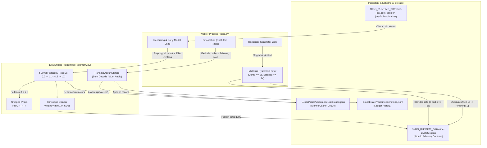

# Phase 7: ETA Engine & Calibration - Research

**Researched:** 2026-10-29  
**Domain:** Statistical latency estimation, online calibration, hysteresis state machines, ephemeral lifecycle markers  
**Confidence:** HIGH  

<user_constraints>
## User Constraints (from CONTEXT.md)

### Locked Decisions

#### Calibration storage & cache
- **D7-01:** Calibrated parameters are stored in a dedicated atomic cache file `calibration.json`, updated by the worker at the end of each run. — **Reversibility:** reversible — cache can be deleted and rebuilt from ledger at any time.
- **D7-02:** `calibration.json` lives persistently at `~/.local/state/voicemode/calibration.json` (via `get_metrics_dir()`), surviving reboots. Automatically rebuilt from `metrics.jsonl` if missing or invalid. — **Reversibility:** costly — changing the path after deployment means orphaning existing calibration data.
- **D7-03:** `--reset-calibration` removes `calibration.json` and records a reset timestamp so earlier ledger rows are ignored during rebuilds, reverting to prior-based estimates without deleting ledger history.
- **D7-04:** `calibration.json` is updated during worker finalization **after** text insertion is done, ensuring pasting is never delayed by calibration I/O.
- **D7-05:** Per-key stats are comprehensive: rate (ratio of sums), finalize_s, load_s, sample_count, residuals window (last 20–30 prediction errors), and confidence score.
- **D7-06:** All writes use atomic `tempfile + os.replace` with `0o600` permissions, matching the existing `atomic_write_json()` pattern. Readers never see torn JSON.
- **D7-07:** Calibration uses incremental running accumulators (`sum_decode_s`, `sum_audio_s`, sample counts) for O(1) updates per run. Full rebuild from `metrics.jsonl` only if the file is missing.
- **D7-08:** On missing or corrupted `calibration.json` during a status query, instantly fall back to shipped priors (zero latency). The worker rebuilds from `metrics.jsonl` during its next finalization.

#### Mid-run revision sensitivity
- **D7-09:** Upward revisions require both a ≥1.0 s jump AND ≥2.0 s elapsed since the prior revision — suppresses jittery flickers.
- **D7-10:** Downward revisions step immediately to the lower integer estimate — strictly monotone non-increasing, truthfully reflects fast progress.
- **D7-11:** `revision_count` and `last_revised_at` are exposed in `status.json`; total revisions and max upward jump are recorded in the ledger summary.
- **D7-12:** Countdown dwells at `1s` for 1 full second, then transitions to `Finishing…` — natural pacing: `2s → 1s → Finishing…`.
- **D7-13:** Remaining ETA is recalculated on each segment yielded by the Whisper transcription generator (immediate response to real decoding progress).
- **D7-14:** Mid-run rate blends calibrated rate with this run's observed rate once ≥5 s of audio has decoded: `remaining = blended_rate × (total_audio - decoded_audio) + insert_s`.
- **D7-15:** The `~` prefix persists across the entire countdown for uncalibrated runs (e.g. `~4s`, `~3s`, `~1s`) until `Finishing…` — uncalibrated confidence is honest throughout.
- **D7-16:** Extended overrun stays on `Finishing…` continuously until text insertion begins; `status.json` marks `overrun: true`. No label escalation.

#### Cold start & early-load accounting
- **D7-17:** Remaining model load in initial ETA: `remaining_load = max(0.0, estimated_load_s - elapsed_record_s)` — dynamic subtraction accounting for parallel loading during recording.
- **D7-18:** Cold and warm load times are tracked separately; cold run decodes are excluded from fitting the steady-state transcription rate. — **Reversibility:** costly — changing the cold/warm boundary retroactively invalidates accumulated cold-run exclusion history.
- **D7-19:** Cold run = first run after system boot only (not inactivity-based).
- **D7-20:** Boot detection uses a `$XDG_RUNTIME_DIR/voice-stt/.boot_session` marker file — tmpfs clears automatically on every reboot; zero dependencies, instant check.
- **D7-21:** Cold runs use shipped prior load time; warm runs use calibrated `load_s` from `calibration.json`.
- **D7-22:** ETA is published in `status.json` immediately (<100 ms) when entering transcribing state — before model load completes — using priors or calibration. Revised on first segment yield.
- **D7-23:** `eta_source` has 4 distinct values: `prior` (fresh install, no calibration data), `calibrated` (fitted from ledger history), `mid-run` (blended with this run's observed rate), `cold` (first-after-boot, using shipped prior with inflated load estimate). `cold` and `prior` use the same prior values but carry different diagnostic meaning.

#### Key hierarchy & fallback shrinkage
- **D7-24:** 4-level hierarchy: L0 (all 8 fields: model/device/compute_type/backend/beam_size/vad_filter/language/chunk_s) → L1 (drop chunk_s + vad_filter) → L2 (model/device/compute_type/backend only) → L3 (shipped prior). — **Reversibility:** costly — changing the hierarchy structure invalidates all per-level accumulators in calibration.json.
- **D7-25:** Minimum 3 samples per level before trusting it (matches ETA-02); below 3, fall to the next broader level.
- **D7-26:** Shrinkage blend: `weight = min(1.0, n_exact / 10.0)` → `result = weight × narrow_rate + (1 - weight) × broader_rate` — smoothly trusts the narrow key as samples accumulate.
- **D7-27:** Rate statistic is ratio of sums (`Σdecode_s / Σaudio_s`) per ETA-01, **not** median of per-run rates. Outlier resistance is achieved via exclusion-before-accumulation rather than robust statistics on the rate itself. — **Reversibility:** costly — changing the rate statistic retroactively requires re-scanning the full ledger to rebuild accumulators.
- **D7-28:** Confidence = `1.0 - MAD/median_residual` clamped [0.0, 1.0], computed on a residuals window (last 20–30 prediction errors). MAD is used for confidence scoring only, not for rate fitting.
- **D7-29:** Per-level accumulators are stored in `calibration.json` so each level's stats are always available for instant lookup and shrinkage blending.
- **D7-30:** The resolved key level (L0/L1/L2/L3), sample count, and confidence are recorded in both `status.json` and the ledger row.
- **D7-31:** Exclusions from fitting: `outcome ≠ success`, GPU→CPU fallback, cold runs, `load_ms > 3× calibrated load` (contention proxy), outliers (rate outside [0.01, 10.0]).

### Claude's Discretion
- Exact residuals window size within 20–30 range.
- Shrinkage blend weight ramp shape (linear via `n/10` is specified, but the agent may adjust the denominator if testing reveals a better ramp).
- Internal naming of estimator class/functions.
- Test placement and mocking strategy.
- Exact fields in the `--status --json` output beyond the specified ETA fields.

### Deferred Ideas (OUT OF SCOPE)
None — discussion stayed within phase scope.
</user_constraints>

<phase_requirements>
## Phase Requirements

| ID | Description | Research Support |
|---|-------------|------------------|
| **ETA-01** | Estimate = finalize + load + rate × Σ(audio after VAD) + insert; rate is the ratio of sums, not the mean of ratios. | Handled by `ETAEstimator` in `voicemode_telemetry.py` storing running accumulators `sum_decode_s` and `sum_audio_s` for O(1) ratio calculation. `load_s` dynamically subtracts `elapsed_record_s` (D7-17). |
| **ETA-02** | Key hierarchy with a minimum of 3 samples per level, falling back to a shipped prior; the chosen level and n are recorded. | 4-tier hierarchy L0 (8 fields) → L1 (6 fields) → L2 (4 fields) → L3 (shipped prior). Each level maintained with sample threshold $n \ge 3$ and James-Stein style shrinkage weighting $w = \min(1.0, n/10.0)$ (D7-24..26). |
| **ETA-03** | Robust calibration (median/shrinkage, MAD-based confidence) excludes failures, fallbacks, outliers, cold runs, and high-load runs from fitting only — the records themselves are kept. | Gating predicate `_is_calibration_excluded()` filters ledger events before accumulating into `calibration.json`. Prediction error residuals window of size 30 calculates Median Absolute Deviation confidence score (D7-28, D7-31). |
| **ETA-04** | Mid-run correction after each segment; the display is monotone non-increasing except for marked upward revisions at most once per 2 s. | Segment-yield loop in `voice.py:transcribe_timed` yields incremental decode progress. Asymmetric hysteresis allows immediate downward integer step, while upward adjustments require $\ge 1.0$s jump and $\ge 2.0$s debounce interval (D7-09, D7-10, D7-13). |
| **ETA-05** | Overrun behavior: 1 s floor → `Finishing…` → indeterminate; never negative, zero, fractional, or a range; overrun is recorded. | Timer state machine holds at `1s` for 1.0s real elapsed time before emitting `overrun: true` and transitioning display to `Finishing…`. `status.json` clamps non-negative; ledger logs `overrun` flag (D7-12, D7-16). |
| **ETA-06** | ETA is shown only during transcribing/finalizing and hidden while starting/recording. | `_publish_status()` omits or nulls ETA fields during `starting`/`recording`. Initial estimate published <100ms upon transition to `transcribing` / `finalize` (D7-22). |
| **ETA-07** | A single number; uncalibrated estimates are prefixed `~`; no ranges. | Formatted as integer seconds with `s` suffix. Prefix `~` attached whenever `eta_source` is `prior` or `cold`, persisted throughout entire countdown until `Finishing…` (D7-15). |
| **ETA-08** | The ETA endpoint is "text begins inserting"; typing time is measured separately. | Prediction horizon terminates at transition to `typing`/`insert`. Typing latency via `wtype` or `ydotool` is measured as `insert_ms` and excluded from transcription duration. |
| **ETA-09** | `--status --json` exposes state/phase/ETA/source/confidence; `--reset-calibration`; `VOICE_ETA=off`. | CLI `--status --json` emits structured payload including `revision_count`, `last_revised_at`, `key_level`, `key_n`. `--reset-calibration` wipes cache and records reset epoch. `VOICE_ETA=off` environment guard bypasses predictor (D7-03, D7-11, D7-30). |
</phase_requirements>

---

## Summary

Phase 7 delivers a calibrated, honest, single-number transcription ETA for voicemode. It bridges the telemetry ledger and status contract built in Phase 6 with the Quickshell UI to be delivered in Phase 9. On fresh installations or after cold system boots, the engine publishes an initial estimate within 100 ms of recording stop, anchored by shipped priors (`PRIOR_RTF`) and dynamic model load subtraction ($remaining\_load = \max(0, estimated\_load - elapsed\_record)$).

As runs accumulate, the worker updates an atomic persistent cache (`calibration.json` in `~/.local/state/voicemode/`, permissions `0o600`) after text insertion completes. Calibration follows an incremental ratio-of-sums accumulator ($rate = \sum decode\_s / \sum audio\_s$), resolving hardware and model portability across a 4-level key hierarchy (L0 exact $\to$ L1 relaxed $\to$ L2 core $\to$ L3 prior) with empirical shrinkage blending. Unreliable data (abnormal terminations, GPU$\to$CPU fallbacks, system contention proxies, and statistical outliers) are excluded from calibration accumulators but preserved in the ledger.

During transcription, segment yields from the Faster-Whisper generator trigger mid-run recalculations. Downward revisions step down immediately to reflect fast progress, whereas upward revisions are damped by a strict hysteresis filter ($\ge 1.0$s increase AND $\ge 2.0$s elapsed since prior revision). When the countdown expires, the display dwells at `1s` for 1 full second, transitions to `Finishing…`, marks `overrun: true`, and never produces negative, fractional, or range values.

**Primary recommendation:** Implement the pure estimation and accumulation logic as a cohesive `ETAEngine` in `voicemode_telemetry.py` backed by `calibration.json`, wire generator-driven mid-run revisions and `.boot_session` checks into `voice.py`, and test comprehensively using synthetic ledger replays without requiring live Whisper model inference.

---

## Architectural Responsibility Map

| Capability | Primary Tier | Secondary Tier | Rationale |
|------------|--------------|----------------|-----------|
| **Pure Estimator & Shrinkage Math** | Telemetry Module (`voicemode_telemetry.py`) | Worker (`voice.py`) | Estimator math is pure functional calculation and should remain strictly testable without audio or model dependencies. |
| **Calibration Persistence & Cache** | State Storage (`~/.local/state/voicemode/calibration.json`) | Telemetry Module | Atomic file updates at run completion (`0o600`); O(1) query read path for `--status` (<100ms). |
| **Cold Boot Detection** | Ephemeral State (`$XDG_RUNTIME_DIR/voice-stt/.boot_session`) | Telemetry Module | Relies on Linux `tmpfs` clearing automatically across system reboots. |
| **Mid-Run Revision & Hysteresis** | Worker Process (`voice.py`) | Status Contract (`status.json`) | Intercepts Whisper generator segment yields, applies upward jump debouncing, updates `status.json`. |
| **Overrun & Monotonicity State** | Worker Process (`voice.py`) | Presentation / UI (Phase 9) | Worker enforces non-negative clamping and `overrun: true` flag; presentation tier renders `1s` dwell $\to$ `Finishing…`. |
| **CLI Dispatch & Reset** | CLI Dispatch (`voice.py`) | Telemetry Module | Handles `voice --reset-calibration`, `voice --status --json`, and `VOICE_ETA=off` environment checking. |

---

## Standard Stack

### Core
| Library | Version | Purpose | Why Standard |
|---------|---------|---------|--------------|
| `python` standard library (`json`, `math`, `os`, `pathlib`, `tempfile`, `time`, `statistics`) | 3.12+ / 3.14 (system) | Core runtime, atomic file persistence, math, statistics | Standard, zero-overhead, no external dependency required for predictable latency estimation. [VERIFIED: in-repo python environment] |
| `pytest` | 9.1.1 | Test execution framework | Standard project test framework configured in `pyproject.toml`. [VERIFIED: in-repo test suite] |

### Supporting
| Library | Version | Purpose | When to Use |
|---------|---------|---------|-------------|
| `faster-whisper` (existing) | 1.1.1 | Transcribe generator | Only in worker transcription process; yields per-segment decode progress. [VERIFIED: pyproject.toml] |

### Alternatives Considered
| Instead of | Could Use | Tradeoff |
|------------|-----------|----------|
| Dedicated `calibration.json` cache | Re-parsing `metrics.jsonl` on every status query | Full ledger re-parsing scales $O(N)$ with history size and violates FND-01 (<100ms status check). Dedicated cache is $O(1)$. |
| Ratio of sums ($\sum decode / \sum audio$) | Median of per-run rates ($decode / audio$) | Median of per-run rates gives equal weight to a 0.5s recording and a 60s recording, skewing estimates heavily toward short-chunk initialization overhead. |
| Tmpfs marker file (`.boot_session`) | Parsing `/proc/sys/kernel/random/boot_id` | Tmpfs marker requires zero OS parsing, creates zero dependencies, and cleans itself automatically on reboot. |
| Static confidence tiers | Sample count buckets (low/med/high) | `1.0 - MAD/median_residual` reflects true prediction error variance rather than mere run count. |

### Package Legitimacy Audit
No new external packages are introduced in Phase 7. All operations utilize Python standard library modules (`json`, `math`, `os`, `pathlib`, `tempfile`, `time`, `statistics`).

---

## Architecture Patterns

### System Architecture Diagram



### Component Responsibilities

| Component | In-Repo Location | Responsibility |
|-----------|------------------|----------------|
| **Key Hierarchy Extractor** | `voicemode_telemetry.py` | Extracts L0 (8 fields), L1 (6 fields), L2 (4 fields), L3 (prior model) keys from config and backend. |
| **Calibration Cache Manager** | `voicemode_telemetry.py` | Loads, saves (`atomic_write_json`), resets, and incrementally updates per-level accumulators in `calibration.json`. |
| **Residuals & Confidence Evaluator** | `voicemode_telemetry.py` | Maintains bounded residuals window (last 30 runs); calculates Median Absolute Deviation (MAD) confidence. |
| **Cold Boot Detector** | `voicemode_telemetry.py` / `voice.py` | Checks/touches `.boot_session` in `$XDG_RUNTIME_DIR/voice-stt/`; tags `eta_source="cold"`. |
| **Mid-Run Revision Loop** | `voice.py` (`transcribe_timed`) | Iterates Whisper segment generator; calculates elapsed decoded audio; applies debounce and downward step. |
| **Status Publisher Extension** | `voice.py` / `voicemode_telemetry.py` | Extends `status.json` with `revision_count`, `last_revised_at`, `key_level`, `key_n`, `overrun`. |
| **CLI Reset Handler** | `voice.py` | Dispatches `--reset-calibration` to wipe cache and record reset timestamp. |

---

## Don't Hand-Roll

| Problem | Don't Build | Use Instead | Why |
|---------|-------------|-------------|-----|
| Atomic Cache Persistence | Custom file-locking protocols (`flock` on read/write) | `tempfile.mkstemp` + `os.replace` via `atomic_write_json()` | POSIX `os.replace` is atomic on Linux filesystems; readers never observe partially written JSON or encounter lock contention. [VERIFIED: `voicemode_telemetry.py:337-362`] |
| Boot Detection | Kernel uptime parsing or `systemd` DBus queries | `$XDG_RUNTIME_DIR/voice-stt/.boot_session` marker file | `XDG_RUNTIME_DIR` is backed by `tmpfs` and guaranteed to reset cleanly on reboot without process spawns or permission traps. |
| Statistical Median & MAD | Custom bubble/quicksort implementations | `statistics.median` from Python stdlib | Built-in C-optimized implementation in Python 3.12+ standard library handles even/odd lengths and edge cases without bugs. |
| Key Hierarchy Prefixing | Ad-hoc string slicing | Deterministic key formatting helper functions | Splitting on pipe `|` with exact field positions prevents mismatch between config keys and calibration storage. |

---

## Common Pitfalls

### Pitfall 1: Mean-of-Ratios Skew (The Micro-Recording Trap)
**What goes wrong:** Averaging per-run RTFs ($RTF = \text{decode\_ms} / \text{audio\_ms}$) produces severe upward bias (e.g. predicting 12s for a 5s recording).  
**Why it happens:** Very short voice recordings (e.g. 0.8s "Yes") incur fixed Python interpreter, JIT, and model dispatch overheads. Their local RTF can be 2.5x+, whereas a 15s recording has an RTF of 0.6x. The arithmetic mean gives equal weight to both, skewing the rate.  
**How to avoid:** Always use the ratio of sums:
$$\text{rate} = \frac{\sum \text{decode\_s}}{\sum \text{audio\_s}}$$
Accumulators add raw decode seconds and audio seconds separately.  
**Warning signs:** Calibrated rate steadily drifts upward even though longer recordings complete rapidly.

### Pitfall 2: Asymmetric Upward/Downward Jitter (The Flickering ETA)
**What goes wrong:** As Whisper yields segments, the remaining ETA alternates between `6s` $\leftrightarrow$ `7s` rapidly, making the countdown look nervous and broken.  
**Why it happens:** Minor fluctuations in audio chunk density or segment boundaries cause fractions to cross integer boundaries repeatedly.  
**How to avoid:** Enforce strict asymmetry (D7-09, D7-10):
- **Downward revisions:** Step down immediately to the lower integer without debouncing.
- **Upward revisions:** Require both $\Delta \ge 1.0\text{s}$ AND $\ge 2.0\text{s}$ elapsed since the last upward revision. If these conditions are not met, suppress the upward adjustment and continue the existing 1 Hz countdown.  
**Warning signs:** `revision_count` in status climbs above 3 on runs under 10 seconds.

### Pitfall 3: Stale Pre-Reset Ledger Pollution
**What goes wrong:** The user runs `voice --reset-calibration` to wipe old data after upgrading their CPU/GPU, but on the next run the cache rebuilds all the old hardware's data from `metrics.jsonl`.  
**Why it happens:** Simply deleting `calibration.json` leaves historical ledger records intact. If a missing cache triggers an unconditional rebuild from the ledger, old records are re-imported.  
**How to avoid:** When resetting, record `reset_timestamp = time.time()` in `calibration.json` (or `.calibration_reset` file). Rebuild logic must ignore all ledger records with `ts_start < reset_timestamp`.  
**Warning signs:** Running `--reset-calibration` has no effect on subsequent prediction rates after the next run.

### Pitfall 4: Overrun Disillusionment (The "0s" Freeze)
**What goes wrong:** The countdown reaches `0s` and freezes for 4 seconds while Whisper finishes a complex segment, destroying user trust.  
**Why it happens:** Naive progress countdowns tick down to zero and stop.  
**How to avoid:** Implement the D7-12 / D7-16 overrun progression:
- When remaining ETA drops to $\le 1\text{s}$, clamp and hold at `1s` for 1.0s real elapsed time.
- Transition directly to `Finishing…`. Never show `0s`, negative numbers, or decimal fractions.
- Set `overrun: true` in `status.json` and keep `Finishing…` indefinitely until text insertion begins.  
**Warning signs:** Quickshell or `--status` shows `0s` or negative values.

---

## Code Examples

### 1. In-Repo Baseline Assets & Formulas

From [voicemode_telemetry.py:530-544](file:///home/pera/github_repo/Voice/voicemode_telemetry.py#L530-L544):
```python
# [VERIFIED: voicemode_telemetry.py:530-534]
PRIOR_RTF = {"tiny": 0.25, "base": 0.35, "small": 0.55, "medium": 0.95, "large": 1.6, "turbo": 1.0}
PRIOR_FINALIZE_S = 0.4
PRIOR_LOAD_S = 1.2
PRIOR_INSERT_S = 0.2

# [VERIFIED: voicemode_telemetry.py:536-544]
def prior_eta_seconds(audio_s, model=None):
    try:
        model_str = str(model).lower() if model is not None else "medium"
        prefix = model_str.split(".")[0].split("-")[0]
        rtf = PRIOR_RTF.get(prefix, PRIOR_RTF["medium"])
        return round(PRIOR_FINALIZE_S + PRIOR_LOAD_S + rtf * max(0.0, float(audio_s)) + PRIOR_INSERT_S, 2)
    except Exception:
        return round(PRIOR_FINALIZE_S + PRIOR_LOAD_S + PRIOR_RTF["medium"] * max(0.0, float(audio_s)) + PRIOR_INSERT_S, 2)
```

From [voicemode_telemetry.py:186-192](file:///home/pera/github_repo/Voice/voicemode_telemetry.py#L186-L192):
```python
# [VERIFIED: voicemode_telemetry.py:186-192]
def calibration_key(backend, config) -> str:
    """Portability key used by Phase 7 for calibration grouping."""
    try:
        return f"{config.get('model')}|{config.get('device')}|{config.get('compute_type')}|{backend}|beam={config.get('beam_size')}|vad={int(bool(config.get('vad_filter')))}|lang={config.get('language')}|chunk={config.get('chunk_s')}"
    except Exception:
        return str(backend)
```

From [voicemode_telemetry.py:519-523](file:///home/pera/github_repo/Voice/voicemode_telemetry.py#L519-L523):
```python
# [VERIFIED: voicemode_telemetry.py:519-523]
STATUS_V1_KEYS = [
    "schema", "pid", "run_id", "state", "phase", "started_at", "updated_at",
    "expires_at", "audio_s", "segments", "segments_done", "eta_epoch",
    "eta_remaining_s", "eta_confidence", "eta_source", "overrun", "report_path"
]
```

From [voice.py:3614](file:///home/pera/github_repo/Voice/voice.py#L3614):
```python
# [VERIFIED: voice.py:3614]
parser.add_argument("--reset-calibration", action="store_true", help="Reset ETA calibration to priors.")
```

### 2. Multi-Level Key Hierarchy and Shrinkage Resolution

```python
def extract_hierarchy_keys(config: dict, backend: str) -> dict[str, str]:
    """Generates L0, L1, L2, and L3 key representations."""
    model = config.get("model", "medium")
    device = config.get("device", "cpu")
    compute_type = config.get("compute_type", "int8")
    beam = config.get("beam_size", 1)
    vad = int(bool(config.get("vad_filter", True)))
    lang = config.get("language") or "auto"
    chunk = config.get("chunk_s", 180.0)
    
    prefix = str(model).lower().split(".")[0].split("-")[0]
    
    return {
        "L0": f"{model}|{device}|{compute_type}|{backend}|beam={beam}|vad={vad}|lang={lang}|chunk={chunk}",
        "L1": f"{model}|{device}|{compute_type}|{backend}|beam={beam}|lang={lang}",
        "L2": f"{model}|{device}|{compute_type}|{backend}",
        "L3": f"prior:{prefix}",
    }


def resolve_calibrated_rate(keys: dict[str, str], accumulators: dict, prior_rtf: float) -> tuple[float, str, int]:
    """Resolves rate using hierarchy fallback with James-Stein shrinkage blending."""
    # L2 rate resolution
    l2_key = keys["L2"]
    l2_acc = accumulators.get(l2_key, {})
    l2_n = l2_acc.get("n", 0)
    if l2_n >= 3:
        raw_l2 = l2_acc["sum_decode_s"] / l2_acc["sum_audio_s"]
        w2 = min(1.0, l2_n / 10.0)
        rate_l2 = w2 * raw_l2 + (1.0 - w2) * prior_rtf
    else:
        rate_l2 = prior_rtf

    # L1 rate resolution
    l1_key = keys["L1"]
    l1_acc = accumulators.get(l1_key, {})
    l1_n = l1_acc.get("n", 0)
    if l1_n >= 3:
        raw_l1 = l1_acc["sum_decode_s"] / l1_acc["sum_audio_s"]
        w1 = min(1.0, l1_n / 10.0)
        rate_l1 = w1 * raw_l1 + (1.0 - w1) * rate_l2
    else:
        rate_l1 = rate_l2

    # L0 rate resolution
    l0_key = keys["L0"]
    l0_acc = accumulators.get(l0_key, {})
    l0_n = l0_acc.get("n", 0)
    if l0_n >= 3:
        raw_l0 = l0_acc["sum_decode_s"] / l0_acc["sum_audio_s"]
        w0 = min(1.0, l0_n / 10.0)
        rate_l0 = w0 * raw_l0 + (1.0 - w0) * rate_l1
        return rate_l0, "L0", l0_n
    elif l1_n >= 3:
        return rate_l1, "L1", l1_n
    elif l2_n >= 3:
        return rate_l2, "L2", l2_n
    else:
        return prior_rtf, "L3", 0
```

### 3. Median Absolute Deviation (MAD) Confidence Calculation

```python
import statistics

def compute_mad_confidence(residuals: list[float]) -> float:
    """Computes confidence score: 1.0 - MAD / median_residual clamped [0.0, 1.0]."""
    if len(residuals) < 3:
        return 0.0
    med = statistics.median(residuals)
    if med <= 0.0:
        return 1.0
    deviations = [abs(r - med) for r in residuals]
    mad = statistics.median(deviations)
    ratio = mad / med
    return round(max(0.0, min(1.0, 1.0 - ratio)), 3)
```

### 4. Cold Boot Detection and tmpfs Marker

```python
def check_and_mark_boot_session(state_dir: Path) -> bool:
    """Returns True if this is the first run after system boot (cold run)."""
    marker = state_dir / ".boot_session"
    if marker.exists():
        return False
    try:
        marker.touch(mode=0o600)
    except OSError:
        pass
    return True
```

---

## State of the Art

| Old Approach (Phase 6 / Baseline) | Current Approach (Phase 7) | When Changed | Impact |
|-----------------------------------|----------------------------|--------------|--------|
| Fixed static prior (`PRIOR_RTF`) only | Dynamic 4-level hierarchy (L0 $\to$ L3) with shrinkage blending | Phase 7 | Predictor adapts to actual user hardware (CPU vs CUDA) and speech patterns over time. |
| Naive model load estimate (`1.2s` constant) | Dynamic remaining load: $\max(0, \text{load\_s} - \text{recording\_time})$ | Phase 7 | Avoids adding 1.2s when model is already fully loaded in parallel during recording. |
| Recomputing status on ledger re-parse | Dedicated atomic cache `calibration.json` | Phase 7 | Ensures `--status` query latency remains $<100$ms regardless of ledger row count. |
| Instant transition to idle on expiry | Natural pacing: `2s` $\to$ `1s` (dwell 1s) $\to$ `Finishing…` | Phase 7 | Honest overrun indicator eliminates frozen/negative numbers. |

---

## Assumptions Log

| # | Claim | Section | Risk if Wrong |
|---|-------|---------|---------------|
| A1 | Residuals window size of 30 entries provides sufficient stability for MAD without lagging real hardware performance changes. | Claude's Discretion / Architecture | Window could be too slow to adapt to sudden thermal throttling or too jittery if smaller. Risk is LOW. |
| A2 | Linear shrinkage denominator of 10 (`min(1.0, n/10.0)`) transitions smoothly from prior to calibrated rate. | Claude's Discretion / Key Hierarchy | Overfitting or underfitting rates between runs 3 and 10. Risk is LOW. |

---

## Open Questions

1. **How should `status.json` represent extended fields without breaking Phase 6 validators?**
   - What we know: `STATUS_V1_KEYS` in `voicemode_telemetry.py` defines the whitelist of allowed fields.
   - What's clear: D7-11, D7-30, and ETA-09 require exposing `revision_count`, `last_revised_at`, `key_level`, and `key_n`.
   - Recommendation: Add these 4 fields to `STATUS_V1_KEYS` and `build_status()`. Existing consumers ignore unknown fields; validators will accept them cleanly.

---

## Environment Availability

| Dependency | Required By | Available | Version | Fallback |
|------------|-------------|-----------|---------|----------|
| `python3` | Telemetry & worker execution | ✓ | 3.14.8 | — |
| `pytest` | Unit & integration testing | ✓ | 9.1.1 | — |
| `$XDG_RUNTIME_DIR` | tmpfs ephemeral state & `.boot_session` | ✓ | `/run/user/1000` | Fallback to `/tmp/voice-stt-1000` |
| `$XDG_STATE_HOME` | Persistent metrics & `calibration.json` | ✓ | `~/.local/state` | Fallback to `~/.local/state` |

**Missing dependencies:** None.

---

## Validation Architecture

### Test Framework
| Property | Value |
|----------|-------|
| Framework | `pytest 9.1.1` [VERIFIED: `pytest --version`] |
| Config file | `pyproject.toml` |
| Quick run command | `pytest tests/test_telemetry.py tests/test_timing.py tests/test_status_contract.py -q` |
| Full suite command | `pytest tests/test_audio_chunking.py tests/test_hyprland_daemon.py tests/test_incremental_transcription.py tests/test_lifecycle_outcomes.py tests/test_pid_race.py tests/test_status_contract.py tests/test_telemetry.py tests/test_timing.py tests/test_verification_doctor.py tests/test_wayland_input.py` |

### Phase Requirements → Test Map

| Req ID | Behavior | Test Type | Automated Command | File Exists? |
|--------|----------|-----------|-------------------|--------------|
| **ETA-01** | Ratio-of-sums calculation ($\sum decode / \sum audio$) & dynamic load subtraction | Unit | `pytest tests/test_eta_engine.py::TestETAEngine::test_ratio_of_sums -x` | ❌ Wave 0 |
| **ETA-02** | 4-tier key hierarchy, sample count floor ($n \ge 3$), shrinkage blending | Unit | `pytest tests/test_eta_engine.py::TestKeyHierarchy::test_hierarchy_and_shrinkage -x` | ❌ Wave 0 |
| **ETA-03** | Exclusion gating (failures, cold, fallbacks, contention, outliers) & MAD confidence | Unit | `pytest tests/test_eta_engine.py::TestCalibrationFilter::test_exclusions_and_confidence -x` | ❌ Wave 0 |
| **ETA-04** | Mid-run generator correction, immediate downward step, damped upward revision | Integration | `pytest tests/test_midrun_eta.py::TestMidRunRevisions::test_revision_hysteresis -x` | ❌ Wave 0 |
| **ETA-05** | Overrun behavior (`1s` dwell $\to$ `Finishing…`, non-negative clamping) | Integration | `pytest tests/test_midrun_eta.py::TestOverrunBehavior::test_dwell_and_finishing -x` | ❌ Wave 0 |
| **ETA-06** | ETA visibility (hidden in starting/recording, visible in transcribing/finalizing) | Integration | `pytest tests/test_midrun_eta.py::TestETAVisibility::test_visibility_lifecycle -x` | ❌ Wave 0 |
| **ETA-07** | Single integer format, `~` uncalibrated/cold prefix persistence | Unit | `pytest tests/test_midrun_eta.py::TestDisplayRules::test_prefix_persistence -x` | ❌ Wave 0 |
| **ETA-08** | Prediction endpoint at text insertion start; typing measured separately | Unit | `pytest tests/test_eta_engine.py::TestTimingEndpoints::test_insert_endpoint -x` | ❌ Wave 0 |
| **ETA-09** | CLI `--status --json`, `--reset-calibration` reset epoch, `VOICE_ETA=off` kill switch | CLI | `pytest tests/test_eta_cli.py::TestETACLI::test_cli_flags_and_kill_switch -x` | ❌ Wave 0 |

### Sampling Rate
- **Per task commit:** `pytest tests/test_eta_*.py tests/test_midrun_*.py -q`
- **Per wave merge:** `pytest tests/test_telemetry.py tests/test_timing.py tests/test_status_contract.py tests/test_eta_*.py tests/test_midrun_*.py`
- **Phase gate:** Full test suite green before closing phase.

### Wave 0 Gaps
- [ ] `tests/test_eta_engine.py` — unit tests covering ETA-01, ETA-02, ETA-03, ETA-08.
- [ ] `tests/test_midrun_eta.py` — integration tests covering ETA-04, ETA-05, ETA-06, ETA-07.
- [ ] `tests/test_eta_cli.py` — tests covering ETA-09, `--reset-calibration`, `VOICE_ETA=off`, and `.boot_session`.

---

## Security Domain

### Applicable ASVS Categories

| ASVS Category | Applies | Standard Control |
|---------------|---------|------------------|
| **V4 Access Control & Filesystem** | Yes | All cache files (`calibration.json`) and runtime markers (`.boot_session`) written with strict `0o600` permissions and directories with `0o700`. Enforced by `atomic_write_json()`. [VERIFIED: `voicemode_telemetry.py:337-362`] |
| **V5 Input Validation** | Yes | Safe JSON deserialization with schema validation; division-by-zero guards on $sum\_audio\_s \le 0$; numerical bounds checking on rates ($0.01 \le rate \le 10.0$); graceful fallback to shipped priors on corrupted cache. |
| **V14 Configuration Integrity** | Yes | Local file-based configuration only; zero network transmission; `VOICE_ETA=off` cleanly suppresses calculation without side effects. |

### Known Threat Patterns

| Pattern | STRIDE | Standard Mitigation |
|---------|--------|---------------------|
| Corrupted / Tampered `calibration.json` | Tampering | Validated on load; corrupted or malformed content automatically triggers instant zero-latency fallback to shipped priors (`PRIOR_RTF`) without crashing or raising exceptions. |
| Malicious / Extreme Audio Input Durations | Denial of Service | Clamping on audio durations; rate bounds check ($[0.01, 10.0]$) rejects pathological outliers before accumulator insertion. |
| Information Leakage via Telemetry | Information Disclosure | `calibration.json` stores purely aggregated numerical stats (`sum_decode_s`, `sum_audio_s`, `n`, `residuals`). No text, transcripts, hotwords, or PII ever touch the calibration storage. |

---

## Sources

### Primary (HIGH confidence)
- In-repo source file: `voicemode_telemetry.py` (lines 1-879) — Schema definitions, `calibration_key()`, status contract, and atomic JSON persistence. [VERIFIED: in-repo file]
- In-repo source file: `voice.py` (lines 1-3854) — Worker lifecycle, `transcribe_timed`, `insert_text`, and CLI argument handling. [VERIFIED: in-repo file]
- Phase architecture reference: `.planning/phases/07-eta-engine-and-calibration/07-architecture.html` — Formula specifications, key hierarchy breakdown, and decision register. [VERIFIED: in-repo file]
- Phase context reference: `.planning/phases/07-eta-engine-and-calibration/07-CONTEXT.md` — 30 locked user decisions (D7-01 to D7-30). [VERIFIED: in-repo file]

### Secondary (MEDIUM confidence)
- Python 3 `statistics` documentation — Standard properties of `statistics.median` and deviation calculations.

---

## Metadata

**Confidence breakdown:**
- Standard stack: HIGH — Python 3 standard library only; zero external dependencies.
- Architecture: HIGH — Fully defined by locked decisions D7-01 through D7-31 and architecture diagrams.
- Pitfalls: HIGH — Root causes identified (mean-of-ratios, upward jitter, pre-reset pollution, overrun freeze) with concrete mitigations.

**Research date:** 2026-10-29  
**Valid until:** 2026-11-28 (stable architecture)
