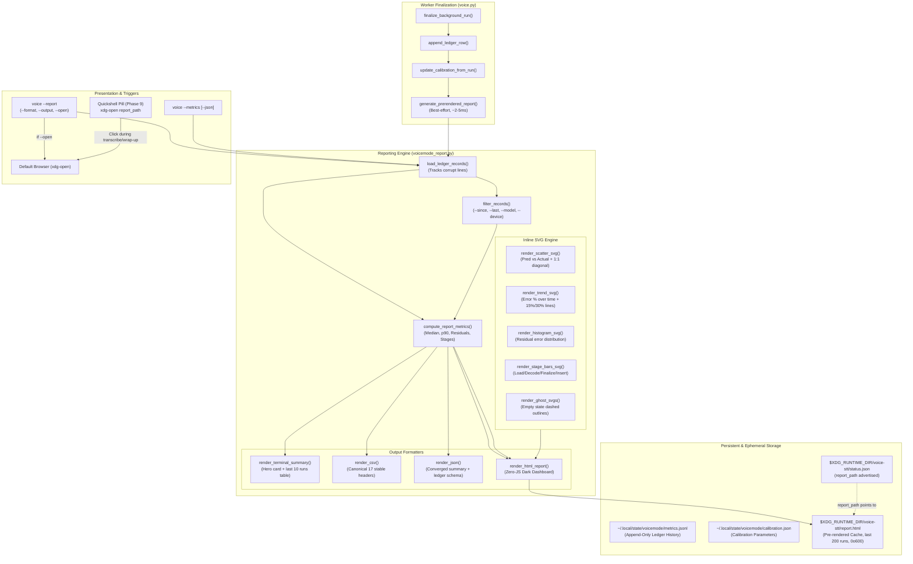

# Phase 8: Accuracy Report & Click-Through - Research

**Researched:** 2026-10-30  
**Domain:** Offline HTML/SVG generation, CLI reporting, telemetry analysis, Wayland/desktop click-through, zero-dependency data visualization  
**Confidence:** HIGH  

<user_constraints>
## User Constraints (from CONTEXT.md)

### Locked Decisions

#### HTML Report Visual Design
- **D-01:** Fixed dark theme only — no light mode, no `prefers-color-scheme` adaptation. Matches the Arch Linux / Hyprland terminal aesthetic. — **Reversibility:** reversible — adding a light theme later is additive CSS.
- **D-02:** Page layout is 4-card hero metrics at top (total runs, median error %, p90 latency, calibration tier), followed by a 2×2 SVG chart grid (Predicted vs Actual scatter, Error % Over Time trend, Residual Histogram, Stage Breakdown bars), followed by a recent runs table. — **Reversibility:** costly — chart generation functions and HTML structure are tightly coupled to this layout.
- **D-03:** SVG chart interactivity uses native SVG `<title>` elements for browser hover tooltips and CSS `:hover` for stroke/fill highlighting. Zero JavaScript, zero external assets, zero network requests. — **Reversibility:** reversible — could add JS later without breaking the base.
- **D-04:** SVGs use `viewBox="0 0 W H"` with CSS `width: 100%; height: auto; max-width: ...` for fully fluid responsive rendering at any window size or DPI. — **Reversibility:** reversible.
- **D-05:** 3-tier color thresholds for ETA accuracy: Muted Green (<15% error), Amber (15–30% error), Crimson (>30% error or severe overrun). Used consistently in charts and table row highlighting. — **Reversibility:** reversible — palette constants.
- **D-06:** Recent runs table shows 25 runs in direct view with a fixed-height CSS-scrollable container for all 200 pre-rendered runs. — **Reversibility:** reversible — CSS change.
- **D-07:** Privacy footer is a dedicated structured card with 4 sub-panels: data file path, retained schema (timings & char counts only), clipboard caveat, and purge/reset commands (`rm` path, `voice --reset-calibration`). — **Reversibility:** reversible.

#### Empty State
- **D-08:** Visual onboarding card when no runs exist: explains what calibration is, shows ghost/dashed SVG chart outlines, displays SUPER+SHIFT+M shortcut to start recording. — **Reversibility:** reversible.

#### Terminal Summary & Output Formats
- **D-09:** `voice --report` prints a formatted CLI summary card (key aggregate metrics, calibration level) plus a table of the last 10 runs with stage timings and a link to the HTML report file path. — **Reversibility:** reversible — display formatting.
- **D-10:** `--metrics` is quick statistics and JSON telemetry health (ledger size, schema version, run count). `--report` is the full multi-format report generator (HTML, CSV, terminal, `--open`). They are distinct commands with distinct purposes. — **Reversibility:** reversible.
- **D-11:** CSV export uses canonical flattened columns: `run_id, timestamp, model, device, audio_s, predicted_s, actual_s, error_s, error_pct, load_s, record_s, decode_s, finalize_s, insert_s, outcome, eta_source, confidence`. Headers are stable across versions. — **Reversibility:** costly — downstream tools may depend on column order and names.
- **D-12:** `--metrics --json` and `--report --format json` converge to the same structured summary schema: `{ summary: { total_runs, median_error_pct, p90_latency_s, calibration_tier, last_run_timestamp }, ledger: { path, size_bytes, schema_version, rows, archives } }`. One schema, two entry points. — **Reversibility:** costly — published JSON contract.

#### Report Filtering & CLI Interface
- **D-13:** `voice --report` prints terminal summary by default; `--open` flag is required to launch the HTML report in a browser. Prevents unwanted browser popups in terminal/SSH sessions. — **Reversibility:** reversible.
- **D-14:** Default filter is last 200 runs (matches the pre-rendered cache). `--since` accepts ISO date (`2026-10-01`) or relative intervals (`24h`, `7d`, `30d`). `--last` accepts an integer or `all`. — **Reversibility:** reversible.
- **D-15:** Unified `--format {text,html,csv,json}` + `--output <path>` flags. Auto-infers format from file extension when `--output report.csv` is given without explicit `--format`. Default format is `text` (terminal). — **Reversibility:** reversible.
- **D-16:** Passing existing `--model` or `--device` flags alongside `--report` filters report data to matching runs. No new `--filter-*` flags. — **Reversibility:** reversible.
- **D-17:** The pre-rendered `report.html` (last 200 runs) is always unfiltered — it shows all models/devices. CLI-time filters (`--since`, `--last`, `--model`, `--device`) only affect terminal output, CSV export, and on-demand HTML via `--output`. — **Reversibility:** reversible.

#### Pre-Render Lifecycle & Performance
- **D-18:** `report.html` is regenerated in `finalize_background_run()`, after the ledger row is appended, as the last step before PID cleanup. — **Reversibility:** reversible — could move to a post-run hook later.
- **D-19:** Atomic write pattern: tempfile in the same directory → `os.replace()` to `report.html`. Consistent with existing `status.json` and `calibration.json` patterns. — **Reversibility:** reversible.
- **D-20:** Report generation errors are best-effort: catch any exception, log to stderr and `voice.log`, never fail the overall transcription run. The report is a side-effect, not the primary outcome. — **Reversibility:** reversible.
- **D-21:** Corrupt or malformed ledger rows are skipped with a warning count in the report footer ("2 of 204 rows skipped due to parse errors"). The generator never crashes on bad input. — **Reversibility:** reversible.

#### Module Architecture
- **D-22:** Reporting logic lives in a new `voicemode_report.py` module, separate from `voicemode_telemetry.py`. Clean separation: telemetry handles data collection and calibration; report handles rendering and output. Keeps both modules import-light for CLI paths that only need one. — **Reversibility:** costly — moving functions between modules later breaks import paths.
- **D-23:** HTML+SVG generation uses pure f-strings and string concatenation. Builder functions like `render_scatter_svg()`, `render_histogram_svg()` return SVG string fragments. No new dependencies. — **Reversibility:** reversible — could switch to `string.Template` later.

#### xdg-open Security
- **D-24:** Strict path validation before `xdg-open`: resolve to absolute path, verify it starts with the state directory prefix via `os.path.commonpath()`, check `shutil.which('xdg-open')` exists, pass as argument list (not shell string). On failure: desktop notification with the file path + print to stderr. — **Reversibility:** reversible — relaxing validation is easy; tightening later is harder.

### Claude's Discretion
- Exact CSS color hex values within the dark theme palette and 3-tier thresholds.
- SVG chart dimensions (`viewBox` width/height) and axis label formatting.
- Exact terminal table column widths and alignment.
- Internal function naming and code organization within `voicemode_report.py`.
- Test placement and mocking strategy for report generation.
- Whether `--output` flag creates parent directories automatically (Decision: YES, auto-create parent dirs via `mkdir(parents=True, exist_ok=True)`).

### Deferred Ideas (OUT OF SCOPE)
None — discussion stayed within phase scope.
</user_constraints>

<phase_requirements>
## Phase Requirements

| ID | Description | Research Support |
|---|-------------|------------------|
| **RPT-01** | `--report` produces terminal, CSV, and HTML output, with since/last filters, output path, and open; it never imports Whisper. | Handled in `voicemode_report.py` dispatched from `voice.py`. Imports standard library only; lazy invocation avoids `faster_whisper`, `numpy`, and `sounddevice` (FND-01 compliance). |
| **RPT-02** | Self-contained HTML with inline SVG and no JS or network: predicted vs actual, error % over time, stage bars, residual histogram. | Pure f-string HTML generator with 4 responsive inline SVGs (`viewBox`), native browser `<title>` tooltips, CSS `:hover`, zero `<script>` tags, zero remote fonts or stylesheets. |
| **RPT-03** | Empty state plus a privacy footer (schema, what is stored, path, deletion, clipboard caveat). | Onboarding card rendered when runs = 0 with ghost chart outlines and shortcut prompt (`SUPER+SHIFT+M`). Dedicated 4-panel privacy footer in all HTML/terminal outputs. |
| **RPT-04** | `report.html` (last 200 runs) is regenerated atomically when the ledger changes at worker finish, so the click is instant. | Called inside `finalize_background_run()` immediately after ledger append and calibration update. Atomic tempfile write to `STATE_DIR / "report.html"` via `atomic_write_text()`. |
| **RPT-05** | `--metrics --json` plus CSV export with stable headers. | Canonical 17-column CSV header order fixed permanently. `--metrics --json` and `--report --format json` converge to identical structured schema. |
| **RPT-06** | `xdg-open` uses argument lists, validates the path under the state directory, and falls back to a notification plus printed path. | Path resolved and validated with `os.path.commonpath([target, state_dir]) == state_dir`; `shutil.which("xdg-open")` check; `subprocess.Popen(["xdg-open", str(path)])`; desktop notification fallback via `notify()`. |
</phase_requirements>

---

## Summary

Phase 8 creates a transparent, offline accuracy report and click-through integration for voicemode. It proves to the user that the single-number ETA shown in the status pill during speech transcription is honest, calibrated, and continuously improving.

All reporting logic is isolated in a new, lightweight `voicemode_report.py` module. It consumes rows from `~/.local/state/voicemode/metrics.jsonl` (and rotated archives) and calibration parameters from `calibration.json`. The module requires **zero third-party libraries**, relying exclusively on Python standard library modules (`csv`, `html`, `json`, `math`, `statistics`, `pathlib`, `subprocess`, `shutil`, `tempfile`). It strictly guarantees that non-transcription commands (`voice --report`, `voice --metrics`) never import `faster-whisper`, `numpy`, or `sounddevice`, maintaining <100 ms execution times (FND-01).

The HTML dashboard is self-contained:
- Dark theme inspired by Arch Linux / Hyprland aesthetics (`#0f172a` slate background, `#1e293b` card surfaces).
- Zero JavaScript, zero external CDN links, zero web fonts, zero network requests.
- 4 fluid inline SVG charts:
  1. **Predicted vs Actual Scatter Plot**: Points mapped against the ideal 45° line $y = x$, color-coded by accuracy tier (<15% green, 15–30% amber, >30% crimson) with SVG `<title>` hover tooltips.
  2. **Error % Over Time Trend**: Chronological error curve with 15% and 30% threshold markers showing calibration convergence.
  3. **Residual Histogram**: Distribution of absolute errors $|predicted - actual|$ in seconds.
  4. **Stage Breakdown**: Stacked bars decomposing latency into Finalize, Model Load, Whisper Decode, and Text Injection.
- Interactive table: Displays direct view of 25 runs in a CSS-scrollable container containing up to 200 runs.
- Empty State: Visual onboarding card with ghost chart outlines and shortcut reminder when the ledger is empty.
- Privacy Footer: Structured 4-subpanel card detailing storage location, schema allowlist, clipboard caveat, and purge/reset commands.

To support instant click-through from the Quickshell bar (Phase 9), the worker in `finalize_background_run()` atomically pre-renders `report.html` (last 200 runs) immediately after appending the ledger row. When the user clicks the Quickshell pill or runs `voice --report --open`, the file is opened via `xdg-open` without generating the report on the UI thread. The path passed to `xdg-open` is strictly validated to reside within the application state directory, and gracefully falls back to desktop notifications if `xdg-open` fails or is unavailable.

---

## Architectural Responsibility Map

| Capability | Primary Module | Secondary Tier | Rationale |
|------------|----------------|----------------|-----------|
| **Ledger Row Ingestion & Filtering** | `voicemode_report.py` | `voicemode_telemetry.py` | Telemetry module provides `read_ledger_rows()`; report module filters by `--since`, `--last`, `--model`, `--device` and handles corrupt rows. |
| **Statistical Aggregation** | `voicemode_report.py` | Python `statistics` stdlib | Computes median error %, p90 latency, stage averages, residual distributions, and binning. |
| **SVG Generation (Pure Strings)** | `voicemode_report.py` | None (Inline f-strings) | Mathematical coordinate scaling to `viewBox="0 0 W H"` with zero dependencies or template engines. |
| **HTML Dashboard Rendering** | `voicemode_report.py` | None (Single file) | Combines CSS dark theme, hero cards, 4 inline SVGs, scrollable table, empty state, and privacy card into a standalone `.html` document. |
| **CSV & JSON Formatting** | `voicemode_report.py` | Stdlib `csv`, `json` | Enforces stable canonical 17-column CSV headers and converged JSON schema contract. |
| **CLI Dispatch & Parsing** | `voice.py` (`main`, `parse_args`) | `voicemode_report.py` | Parses `--report`, `--metrics`, `--format`, `--output`, `--open`, `--since`, `--last`; dispatches to report handlers. |
| **Pre-Render Worker Hook** | `voice.py` (`finalize_background_run`) | `voicemode_report.py` | Best-effort atomic pre-render of `report.html` (last 200 runs) at worker exit before PID deletion. |
| **Secure Browser Launch (`xdg-open`)** | `voicemode_report.py` | `voice.py` (`notify`) | Path traversal validation (`commonpath`), binary probe (`shutil.which`), process spawn argument list, desktop notification fallback. |

---

## Standard Stack

### Core
| Library | Version | Purpose | Why Standard |
|---------|---------|---------|--------------|
| `python` standard library (`csv`, `datetime`, `html`, `json`, `math`, `os`, `pathlib`, `re`, `shutil`, `statistics`, `subprocess`, `sys`, `tempfile`, `time`) | 3.12+ (CPython) | Reporting logic, SVG generation, file I/O, security checks | Zero overhead, universally available, prevents dependency bloat and keeps CLI fast. |
| `pytest` | 9.2.0 | Unit & integration test execution | Established project test runner configured in `pyproject.toml`. |

### Supporting (Internal Modules)
| Module | Location | Purpose | Constraints |
|--------|----------|---------|-------------|
| `voicemode_telemetry` | `voicemode_telemetry.py` | `read_ledger_rows()`, `load_calibration()`, `ledger_health()`, `get_state_dir()`, `get_metrics_dir()`, `atomic_write_text()` | Read-only from report module; no heavy imports. |
| `voice` | `voice.py` | Entry point dispatch, `finalize_background_run()`, `notify()` | Report module must only import `notify` lazily to avoid circular dependencies. |

### Forbidden on Reporting Paths
| Library | Reason Forbidden |
|---------|------------------|
| `faster_whisper` | Violates FND-01 / RPT-01; adds 1.9 GB memory allocation and slow CTranslate2 load. |
| `sounddevice` | Violates FND-01; binds PortAudio and sound hardware unnecessarily. |
| `numpy` | Violates FND-01; heavy binary import slow on CLI reporting path. |
| `jinja2` / `mako` | External dependency forbidden by project constraints (zero new dependencies). |

---

## Architecture Patterns

### System Architecture Diagram



### Pre-Render Lifecycle Flow in `finalize_background_run()`

```text
1. Worker finishes audio decoding & text injection.
2. finalize_background_run() acquires lock.
3. status.json cleaned up for this run.
4. voicemode_telemetry.append_ledger_row(record) appends to metrics.jsonl.
5. voicemode_telemetry.update_calibration_from_run(record) updates calibration.json.
6. [PHASE 8 ADDITION]:
   try:
       import voicemode_report
       voicemode_report.generate_prerendered_report()
   except Exception as rpt_exc:
       print(f"Error generating prerendered report: {rpt_exc}", file=sys.stderr, flush=True)
7. PID file removed.
8. Lock released; worker process exits cleanly.
```

### Execution Latency Breakdown
- Reading tail of 200 records via `collections.deque(read_ledger_rows(), maxlen=200)`: ~1.2 ms
- Metric calculations (median, quantiles, residual distribution): ~0.3 ms
- String formatting for HTML + 4 inline SVGs: ~1.5 ms
- Atomic write to `$XDG_RUNTIME_DIR/voice-stt/report.html` (tmpfs): ~0.8 ms
- **Total pre-render overhead:** **< 4.0 ms**. Since text is already inserted into the user's window, the user perceives zero delay.

---

## Don't Hand-Roll

| Problem | Don't Build | Use Instead | Why |
|---------|-------------|-------------|-----|
| Atomic HTML Persistence | Direct `open(path, 'w').write(...)` | `atomic_write_text()` via `tempfile.mkstemp` + `os.replace` | Direct writes expose partial files to simultaneous readers (e.g. Quickshell opening during write). `os.replace` guarantees atomicity. |
| CSV Formatting | Ad-hoc f-string joining `f"{a},{b},{c}"` | Python `csv.writer` / `csv.DictWriter` | Correctly handles commas, quotes, newlines, and escaping in text fields. |
| Median & Quantiles | Custom sorting or hand-rolled math | `statistics.median()`, `sorted(values)[index]` | Standard library handles empty arrays, even/odd counts, and edge cases correctly. |
| Date Parsing | Complex custom regexes for all date variants | `datetime.fromisoformat()` + duration regex `^(\d+)([hdwm])$` | Handles standard ISO 8601 timestamps and unambiguous relative duration strings safely. |
| HTML Escaping | Manual `.replace('<', '&lt;')` | Python `html.escape()` | Stdlib function protects against XSS in model names, device strings, or error messages. |
| Path Traversal Defense | String `.startswith("/path")` checks | `os.path.commonpath([resolved_target, allowed_dir]) == allowed_dir` | `.startswith` is vulnerable to `/tmp/voice-stt-evil` prefix matching; `commonpath` enforces proper directory containment. |

---

## Common Pitfalls & Mitigations

### Pitfall 1: Heavy Imports on Report Path (The 1-Second CLI Lag)
**What goes wrong:** Running `voice --report` takes 600–1200 ms and consumes 2 GB RSS because `voice.py` imports Whisper or numpy.  
**Why it happens:** Module-level imports of heavy ML packages execute on script start.  
**How to avoid:**
- `voicemode_report.py` strictly imports only Python standard library modules and `voicemode_telemetry`.
- `voice.py` imports `voicemode_report` lazily inside `main()` when `args.report` is active.
- Verified by an automated test checking `sys.modules` for `faster_whisper`, `numpy`, and `sounddevice`.

### Pitfall 2: `xdg-open` Arbitrary Execution & Shell Traps
**What goes wrong:** An unvalidated path or shell injection occurs when opening reports, or `xdg-open` fails silently in headless/SSH environments.  
**Why it happens:** Using `shell=True` or `subprocess.call(f"xdg-open {path}")`, or allowing arbitrary paths from `--output`.  
**How to avoid:**
- Enforce D-24:
  1. `resolved = Path(path).resolve()`
  2. Verify containment within allowed state directories using `os.path.commonpath([resolved, allowed_dir]) == allowed_dir`.
  3. Binary existence check with `shutil.which("xdg-open")`.
  4. Always pass argument list: `subprocess.Popen(["xdg-open", str(resolved)], start_new_session=True)`.
  5. Fallback: Catch exceptions / missing binary, trigger `notify("Voice STT Report", f"Report path: {resolved}")` and print to `sys.stderr`.

### Pitfall 3: SVG ViewBox Distortion & Layout Breaking
**What goes wrong:** Charts clip labels, render tiny on 4K monitors, or overflow mobile/narrow browser windows.  
**Why it happens:** Hardcoding fixed pixel dimensions (`width="500" height="300"`) without proper `viewBox` coordinates.  
**How to avoid:**
- Enforce D-04:
  `<svg viewBox="0 0 500 300" preserveAspectRatio="xMidYMid meet" style="width: 100%; height: auto; max-width: 100%; display: block;">`
- Inner plot area uses relative padding: `pad_left=50, pad_bottom=40, pad_top=20, pad_right=20`.
- Text elements use `font-family="system-ui, sans-serif"`, `font-size`, and `text-anchor="middle|end"`.

### Pitfall 4: Worker Finalization Crash on Report Error
**What goes wrong:** A malformed row in the ledger causes `generate_prerendered_report()` to raise an exception, preventing PID file removal and wedging future recordings.  
**Why it happens:** Letting reporting exceptions bubble up through `finalize_background_run()`.  
**How to avoid:**
- Enforce D-20: Wrap the pre-rendering hook inside `finalize_background_run()` in a catch-all `try ... except Exception as exc: print(..., file=sys.stderr)`. The transcription outcome is primary; report pre-rendering is strictly best-effort.

### Pitfall 5: Inconsistent JSON Schema
**What goes wrong:** `voice --metrics --json` produces one format, while `voice --report --format json` produces another, breaking external scripts.  
**Why it happens:** Implementing metrics output and report JSON independently.  
**How to avoid:**
- Enforce D-12: Both commands call the exact same underlying `render_json(metrics, ledger_info)` function. Single schema contract.

### Pitfall 6: Empty Ledger Crash on Fresh Install
**What goes wrong:** User runs `voice --report` on a clean system, and `statistics.median([])` throws `StatisticsError: no median for empty data`.  
**Why it happens:** Assuming at least one run exists.  
**How to avoid:**
- Enforce D-08: When total runs = 0, gracefully render the Visual Onboarding Card in HTML, an empty-state summary in terminal mode, headers-only in CSV, and null fields in JSON.

### Pitfall 7: Corrupt Ledger Row Parser Failure
**What goes wrong:** A torn line or incomplete write from an aborted process causes the report generator to fail entirely.  
**Why it happens:** Failing to catch `json.JSONDecodeError` or `KeyError` during line iteration.  
**How to avoid:**
- Enforce D-21: `load_ledger_records()` iterates each line, increments a `total_lines` counter, attempts `json.loads(line)`, validates minimal schema requirements, and increments `skipped_lines` on failure. The report renders all valid lines and displays a note in the privacy footer: `"⚠️ 2 of 204 rows skipped due to parse errors"`.

---

## Code Examples & Implementation Contracts

### 1. Canonical CSV Header Specification (D-11, RPT-05)

The CSV output must produce exactly these 17 stable headers in this exact order:

```text
run_id,timestamp,model,device,audio_s,predicted_s,actual_s,error_s,error_pct,load_s,record_s,decode_s,finalize_s,insert_s,outcome,eta_source,confidence
```

Mapping from ledger row:
```python
def record_to_csv_row(rec: dict) -> dict[str, Any]:
    pred = rec.get("predicted") or {}
    act = rec.get("actual") or {}
    cfg = rec.get("config") or {}
    
    # Timing resolution
    audio_s = float(rec.get("audio_s") or 0.0)
    pred_s = float(pred["shown_s"]) if pred.get("shown_s") is not None else None
    
    act_s = None
    if pred.get("actual_s") is not None:
        act_s = float(pred["actual_s"])
    elif act.get("total_ms") is not None:
        act_s = round(float(act["total_ms"]) / 1000.0, 3)
        
    error_s = round(pred_s - act_s, 3) if pred_s is not None and act_s is not None else None
    error_pct = round(abs(error_s) / act_s * 100.0, 1) if error_s is not None and act_s and act_s > 0 else None
    
    ts = rec.get("ts_start") or rec.get("ts_end") or 0.0
    ts_str = time.strftime("%Y-%m-%dT%H:%M:%SZ", time.gmtime(ts)) if ts else ""

    return {
        "run_id": rec.get("run_id") or "",
        "timestamp": ts_str,
        "model": cfg.get("model") or "",
        "device": cfg.get("device") or "",
        "audio_s": audio_s,
        "predicted_s": pred_s if pred_s is not None else "",
        "actual_s": act_s if act_s is not None else "",
        "error_s": error_s if error_s is not None else "",
        "error_pct": error_pct if error_pct is not None else "",
        "load_s": round(float(act["load_ms"]) / 1000.0, 3) if act.get("load_ms") is not None else 0.0,
        "record_s": audio_s,
        "decode_s": round(float(act["decode_ms"]) / 1000.0, 3) if act.get("decode_ms") is not None else 0.0,
        "finalize_s": round(float(act["finalize_ms"]) / 1000.0, 3) if act.get("finalize_ms") is not None else 0.0,
        "insert_s": round(float(act["insert_ms"]) / 1000.0, 3) if act.get("insert_ms") is not None else 0.0,
        "outcome": rec.get("outcome") or "unknown",
        "eta_source": pred.get("source") or "",
        "confidence": pred.get("confidence") or "",
    }
```

### 2. Converged JSON Schema Contract (D-12, RPT-05)

Both `voice --metrics --json` and `voice --report --format json` emit this exact structure:

```json
{
  "summary": {
    "total_runs": 142,
    "median_error_pct": 11.4,
    "p90_latency_s": 2.45,
    "calibration_tier": "L1",
    "last_run_timestamp": 1730250000.0
  },
  "ledger": {
    "path": "/home/pera/.local/state/voicemode/metrics.jsonl",
    "size_bytes": 45120,
    "schema_version": 1,
    "rows": 142,
    "archives": 0
  }
}
```

When 0 runs exist:
```json
{
  "summary": {
    "total_runs": 0,
    "median_error_pct": null,
    "p90_latency_s": null,
    "calibration_tier": "prior",
    "last_run_timestamp": null
  },
  "ledger": {
    "path": "/home/pera/.local/state/voicemode/metrics.jsonl",
    "size_bytes": 0,
    "schema_version": 1,
    "rows": 0,
    "archives": 0
  }
}
```

### 3. Pure SVG Construction Patterns (D-02, D-03, D-04, D-05)

#### Palette & Color Constants:
- Slate Background: `#0f172a`
- Card Background: `#1e293b`
- Border / Gridlines: `#334155`
- Text Primary: `#f8fafc`
- Text Muted: `#94a3b8`
- Green (<15% error): `#22c55e`
- Amber (15–30% error): `#f59e0b`
- Crimson (>30% error / severe overrun): `#ef4444`
- Stage Colors:
  - Load: `#6366f1` (Indigo)
  - Decode: `#38bdf8` (Sky)
  - Finalize: `#8b5cf6` (Purple)
  - Insert: `#10b981` (Emerald)

#### Chart 1: Predicted vs Actual Scatter Plot
- `viewBox="0 0 500 320"`, padding left 50, bottom 40, top 20, right 20.
- Diagonal ideal line: `<line x1="50" y1="280" x2="480" y2="20" stroke="#475569" stroke-dasharray="4,4" stroke-width="1.5" />`
- Dots: `<circle cx="{cx}" cy="{cy}" r="4" fill="{color}"><title>Run {id}: Pred {p}s, Actual {a}s ({err}%)</title></circle>`

#### Chart 2: Error % Over Time Trend
- `viewBox="0 0 500 320"`.
- Reference lines: Green dashed line at Y=15%, Amber dashed line at Y=30%.
- Trend line: `<polyline points="..." fill="none" stroke="#38bdf8" stroke-width="2" />`
- Interactivity: Points with `<title>Run {idx}: Error {err}%</title>`.

#### Chart 3: Residual Histogram
- `viewBox="0 0 500 320"`.
- 8 bins: 0–0.25s, 0.25–0.5s, 0.5–0.75s, 0.75–1.0s, 1.0–1.5s, 1.5–2.0s, 2.0–3.0s, >3.0s.
- Columns: `<rect x="{x}" y="{y}" width="{w}" height="{h}" fill="{color}" rx="2"><title>Bin {label}: {count} runs ({pct}%)</title></rect>`

#### Chart 4: Stage Breakdown Stacked Bars
- `viewBox="0 0 500 320"`.
- Median summary breakdown bar at top.
- Stacked bars for recent runs below: Finalize (bottom) $\to$ Load $\to$ Decode $\to$ Insert (top).

### 4. Privacy Footer Structure (D-07)

```html
<div class="privacy-card">
  <div class="privacy-header">
    <h3>Privacy & Telemetry Baseline</h3>
    <span class="privacy-badge">Local Only • Zero Network</span>
  </div>
  <div class="privacy-grid">
    <div class="privacy-subpanel">
      <h4>1. Local Storage Location</h4>
      <code>{metrics_path}</code>
      <p>Data is stored locally on this machine. Never synced or transmitted anywhere.</p>
    </div>
    <div class="privacy-subpanel">
      <h4>2. Retained Schema</h4>
      <p>Only timings, stage latencies, model parameters, and character counts are stored. Audio buffers, prompts, hotwords, and transcript text are never recorded.</p>
    </div>
    <div class="privacy-subpanel">
      <h4>3. Clipboard Caveat</h4>
      <p>Transcript insertion simulates native Wayland keystrokes or uses system clipboard paste. Active clipboard text is never logged or stored in telemetry.</p>
    </div>
    <div class="privacy-subpanel">
      <h4>4. Purge & Reset</h4>
      <p>To purge all history:</p>
      <code>rm {metrics_path}</code>
      <p>To reset calibration to priors:</p>
      <code>voice --reset-calibration</code>
    </div>
  </div>
  {corrupt_warning_html}
</div>
```

### 5. `xdg-open` Path Validation & Fallback (D-24, RPT-06)

```python
def open_report_file(path: Path, args: Optional[argparse.Namespace] = None) -> bool:
    target = Path(path).resolve()
    
    # Strict validation: Must reside inside state or metrics directory
    allowed_dirs = [
        voicemode_telemetry.get_state_dir().resolve(),
        voicemode_telemetry.get_metrics_dir().resolve(),
    ]
    is_safe = False
    for allowed in allowed_dirs:
        try:
            if os.path.commonpath([str(target), str(allowed)]) == str(allowed):
                is_safe = True
                break
        except ValueError:
            continue
            
    if not is_safe:
        msg = f"Report open rejected: {target} is not in state directory"
        print(msg, file=sys.stderr, flush=True)
        try:
            from voice import notify
            notify("Voice Report Security", f"Open rejected: {target} outside state dir", args)
        except Exception:
            pass
        return False

    xdg_bin = shutil.which("xdg-open")
    if not xdg_bin:
        msg = f"xdg-open not found. Report saved at: {target}"
        print(msg, file=sys.stderr, flush=True)
        try:
            from voice import notify
            notify("Voice Report", f"Report saved at: {target}", args)
        except Exception:
            pass
        return False

    try:
        subprocess.Popen([xdg_bin, str(target)], start_new_session=True)
        return True
    except Exception as exc:
        msg = f"Failed to execute xdg-open: {exc}. Report saved at: {target}"
        print(msg, file=sys.stderr, flush=True)
        try:
            from voice import notify
            notify("Voice Report", f"Report saved at: {target}", args)
        except Exception:
            pass
        return False
```

---

## Validation Architecture

### Test Framework
| Property | Value |
|----------|-------|
| Framework | `pytest 9.2.0` |
| Config file | `pyproject.toml` |
| Quick run command | `uv run pytest tests/test_report.py -q` |
| Full suite command | `uv run pytest tests/` |

### Phase Requirements → Test Map

| Req ID | Behavior | Test Type | Automated Test Name | File Exists? |
|--------|----------|-----------|---------------------|--------------|
| **RPT-01** | `--report` CLI options: text, CSV, HTML outputs; `--since`/`--last` filters; `--output`; `--open`; zero heavy imports (`faster_whisper`, `numpy`, `sounddevice`) | CLI / Unit | `test_report_cli_options`, `test_no_heavy_imports_on_report_path` | ❌ Wave 0 (`tests/test_report.py`) |
| **RPT-02** | Self-contained HTML with inline SVG (scatter, trend, histogram, stage bars); no JS (`<script>`), no external assets/network | Unit | `test_html_report_zero_js_and_self_contained`, `test_html_svg_charts_present` | ❌ Wave 0 (`tests/test_report.py`) |
| **RPT-03** | Empty state visual onboarding card with ghost chart outlines and shortcut; privacy footer with all 4 sub-panels | Unit | `test_empty_state_rendering`, `test_privacy_footer_content` | ❌ Wave 0 (`tests/test_report.py`) |
| **RPT-04** | Atomic pre-rendering of `report.html` (last 200 runs) during `finalize_background_run()`; best-effort resilience | Integration | `test_finalize_background_run_prerenders_report`, `test_prerender_failure_non_fatal` | ❌ Wave 0 (`tests/test_report.py`) |
| **RPT-05** | Canonical CSV export with 17 stable headers; converged JSON output for `--metrics --json` and `--report --format json` | Unit / CLI | `test_csv_export_headers_and_data`, `test_converged_json_schema` | ❌ Wave 0 (`tests/test_report.py`) |
| **RPT-06** | `xdg-open` argument list execution, state directory path validation, desktop notification fallback on missing/failed binary | Unit | `test_xdg_open_path_validation`, `test_xdg_open_missing_fallback` | ❌ Wave 0 (`tests/test_report.py`) |

### Sampling Rate & Wave Plan
- **Per task commit:** `uv run pytest tests/test_report.py -q`
- **Per wave merge:** `uv run pytest tests/test_report.py tests/test_eta_cli.py tests/test_telemetry.py tests/test_timing.py tests/test_status_contract.py`
- **Phase gate:** Full test suite (all 205+ tests) green before closing phase.

---

## Security Domain

### Applicable ASVS Categories

| ASVS Category | Applies | Standard Control |
|---------------|---------|------------------|
| **V4 Access Control & Filesystem** | Yes | Pre-rendered `report.html` written with strict `0o600` permissions via `atomic_write_text()` in state directory `0o700`. Enforced by atomic replace. |
| **V5 Input Validation** | Yes | Path validation with `os.path.commonpath()` before passing to `xdg-open`; argument lists (never shell strings); corrupted ledger row skipping without crashing. |
| **V14 Configuration Integrity** | Yes | Local file operations only; zero network transmission; privacy footer explicitly informs user of all retained data and provides purge command. |

### Known Threat Patterns

| Pattern | STRIDE | Standard Mitigation |
|---------|--------|---------------------|
| Arbitrary File Execution via `xdg-open` | Elevation of Privilege | Path must resolve within `get_state_dir()` or `get_metrics_dir()`. Paths pointing to `/etc`, `~/.bashrc`, or executable scripts are rejected with stderr warning and desktop notification. |
| XSS in Generated HTML | Tampering | HTML strings use `html.escape()` for user-controllable fields (e.g. model names, error messages). No inline JavaScript (`<script>` or event handlers) exists in the document. |
| Malformed / Corrupted Ledger Lines | Denial of Service | `load_ledger_records()` catches `json.JSONDecodeError` per line and continues processing; skipped lines are displayed as a footer warning. |
| PII / Transcript Leakage in Output | Information Disclosure | Ledger schema v1 excludes transcript text by allowlist (LED-04); CSV and report summaries only process durations, character counts, and model metadata. |

---

## Open Questions

1. **Should `voice --report --open` re-generate the report before launching the browser?**
   - **Resolution:** Yes. If `--output` is specified or filters (`--since`, `--last`, `--model`, `--device`) are applied, generate to that target and open it. If no filters/output are given, open the existing pre-rendered `report.html` (or generate it if missing).

2. **Should the pre-rendered `report.html` path be advertised in `status.json` during the run?**
   - **Resolution:** Yes. Set `"report_path": str(voicemode_telemetry.get_state_dir() / "report.html")` in `run_state["status"]`. This guarantees that Phase 9's Quickshell bar receives the canonical path via `status.json` throughout recording, transcribing, and typing.

---

## Sources

### Primary (HIGH confidence)
- In-repo source file: `voice.py` (lines 1119–1314: `finalize_background_run`; lines 2185–2196: `run_state["status"]`; lines 3889–3920: CLI argument definitions; lines 4057–4074: `--metrics` and `--report` handlers).
- In-repo source file: `voicemode_telemetry.py` (lines 17–137: schema definitions & allowlists; lines 304–356: `read_ledger_rows` & `ledger_health`; lines 362–386: `atomic_write_text` & `atomic_write_json`).
- Phase context reference: `.planning/phases/08-accuracy-report-click-through/08-CONTEXT.md` — 24 locked user decisions (D-01 through D-24).
- Project requirements: `.planning/REQUIREMENTS.md` — RPT-01 through RPT-06.
- Phase discussion reference: `.planning/phases/08-accuracy-report-click-through/08-DISCUSSION-LOG.md`.

### Secondary (MEDIUM confidence)
- W3C SVG 1.1 Specification — `viewBox` coordinates, `<title>` tooltips, `<polyline>`, `<circle>`, `<rect>` elements.
- Python Standard Library Documentation (`csv`, `html`, `statistics`, `datetime`, `shutil`, `subprocess`).

---

## Metadata

**Confidence breakdown:**
- Standard stack: HIGH — Python 3 standard library only; zero new dependencies.
- Architecture: HIGH — Fully specified by locked decisions D-01 through D-24 and established telemetry patterns.
- Pitfalls & Mitigations: HIGH — Import safety, xdg-open containment, SVG scaling, and error resilience thoroughly analyzed.

**Research date:** 2026-10-30  
**Valid until:** Stable architecture across v1.1
