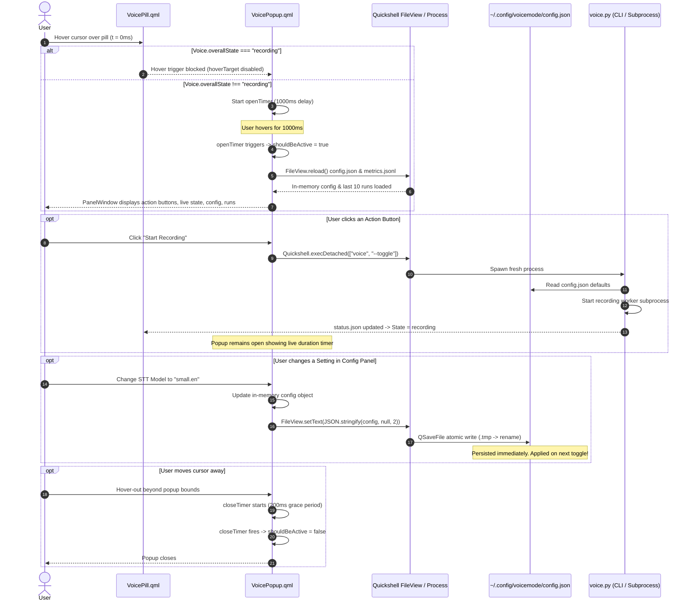

# Phase 11: Voice Desktop Pop-up UI - Research

**Phase:** 11 — Voice Desktop Pop-up UI  
**Status:** Completed  
**Author:** GSD Phase Researcher  
**Target Delivery:** Rich interactive Quickshell overlay popup for voice recording history, settings, and telemetry.  
**Requirement IDs:** POP-01, POP-02  

---

## Summary

Phase 11 delivers a comprehensive Quickshell desktop overlay popup (`VoicePopup.qml`) anchored to the `VoicePill` bar component. The popup is designed to trigger on hover with a 1000ms intent delay matching the existing `CpuGpuPopup` and `MemoryStoragePopup` components, while deliberately blocking new hover activations during active recording to prevent accidental focus loss or microphone disruption (D-01).

The popup consolidates four key user flows into a unified, single-window overlay:
1. **Always-Visible Action Buttons**: Instant access to Start Recording (`#4ade80` Neon Green), Stop Recording (`colPrimary`), and Cancel Recording (`#f43f5e` Crimson), dispatching directly to `voice --toggle` and `voice --cancel` via `Quickshell.execDetached` (D-03, D-04).
2. **Live State Display**: Real-time telemetry during active recording, transcribing, and typing, drawing from `$XDG_RUNTIME_DIR/voice-stt/status.json` and the `Voice` singleton; seamlessly falling back to last-run metrics when idle (D-07).
3. **Interactive Configuration Panel**: 12 persistent settings (Whisper model, compute type, device, language, chunk duration default 5s, typing/paste mode, beam size, VAD filter, audio cues, Kokoro voice, TTS backend, and corpus capture mode) reading and immediately writing to `~/.config/voicemode/config.json` (D-05, D-06). Changes take effect on the very next `voice --toggle` invocation because each toggle launches a fresh detached worker subprocess that parses configuration on startup.
4. **Recent Runs & Telemetry**: Up to 10 recent execution records extracted from `$XDG_STATE_HOME/voicemode/metrics.jsonl` displaying duration, character count, Real-Time Factor (RTF), and outcome indicators (✓ success, ✕ error, ⚠ outlier), paired with an "Open Full Report" button launching `report.html` (D-08, D-09). The recent runs section is enclosed in a `StyledFlickable` with a `StyledScrollBar` so it scrolls cleanly if vertical space is constrained, while action buttons, live state, and configuration controls remain fixed (D-10).

---

## Architectural Responsibility Map

```
┌─────────────────────────────────────────────────────────────────────────────┐
│                             Quickshell Desktop                              │
├─────────────────────────────────────────────────────────────────────────────┤
│  VoicePill.qml (Bar Pill)                                                   │
│    ├── Anchors VoicePopup via hoverTarget                                   │
│    ├── Blocks hover opening when Voice.overallState === "recording"         │
│    └── Disables direct report opening on click (superseded by popup)        │
│                                                                             │
│  VoicePopup.qml (New Overlay Component)                                     │
│    ├── StyledPopup (1000ms hover delay, 200ms close grace, overlay layer)   │
│    ├── ActionButtonBar: Start (Neon Green), Stop (colPrimary), Cancel (Red) │
│    ├── LiveStateCard: Timers & character count (status.json / Voice.qml)    │
│    ├── ConfigPanel: 12 settings controls syncing to config.json             │
│    └── RecentRunsCard: StyledFlickable list (10 runs) + Open Report Button  │
│                                                                             │
│  Voice.qml (Quickshell Singleton Service)                                   │
│    ├── FileView observers: status.json, recorder.pid, tts.pid               │
│    ├── Open report safety gate (Qt.openUrlExternally)                       │
│    └── Telemetry properties: formatted durations, state machine, procfs     │
└─────────────────────────────────────────────────────────────────────────────┘
                                       │
                  ┌────────────────────┴────────────────────┐
                  ▼                                         ▼
      File Contracts (IPC)                      Process Execution
  ├── ~/.config/voicemode/config.json       ├── voice --toggle (Start/Stop)
  ├── $XDG_RUNTIME_DIR/voice-stt/status.json ├── voice --cancel (Abort)
  ├── $XDG_STATE_HOME/voicemode/metrics.jsonl └── report.html opener
  └── $XDG_RUNTIME_DIR/voice-stt/recorder.pid
                  │
                  ▼
┌─────────────────────────────────────────────────────────────────────────────┐
│                          voicemode CLI & Subprocess                         │
├─────────────────────────────────────────────────────────────────────────────┤
│  voice.py                                                                   │
│    ├── parse_args(): Merges CLI args > env vars > config.json > defaults   │
│    ├── load_user_config() / save_user_config(): Atomic JSON file I/O        │
│    ├── background_argv(): Forwards resolved settings to worker subprocess   │
│    └── toggle_background_recording() / cancel_recording()                   │
│                                                                             │
│  voicemode_telemetry.py                                                     │
│    ├── Status schema v1 contract (STATUS_V1_KEYS, publish_status)           │
│    └── Metrics ledger v1 contract (metrics.jsonl, read_ledger_rows)         │
└─────────────────────────────────────────────────────────────────────────────┘
```

---

## Standard Stack

### UI Layer (Quickshell / QtQuick)
- **Framework:** Quickshell 0.3.2 (AUR: `quickshell-git`) [VERIFIED: `quickshell --version`]
- **Base Components:**
  - `StyledPopup.qml`: Foundational popup container with `LazyLoader`, `PanelWindow`, `WlrLayershell.layer: Overlay`, `margins` clamping, and `HoverHandler` bridging [VERIFIED: file:///home/pera/github_repo/.dotfiles/restow/quickshell/.config/quickshell/ii/modules/ii/bar/StyledPopup.qml#L1-L208].
  - `StyledPopupHeaderRow.qml`: Standard section header with icon and typography [VERIFIED: file:///home/pera/github_repo/.dotfiles/vendor/dots-hyprland/dots/.config/quickshell/ii/modules/ii/bar/StyledPopupHeaderRow.qml#L1-L30].
  - `StyledPopupValueRow.qml`: Two-column metric value display row [VERIFIED: file:///home/pera/github_repo/.dotfiles/vendor/dots-hyprland/dots/.config/quickshell/ii/modules/ii/bar/StyledPopupValueRow.qml#L1-L30].
  - `StyledFlickable.qml` & `StyledScrollBar.qml`: Touchpad/mouse-wheel scrollable viewport with native momentum curves [VERIFIED: file:///home/pera/github_repo/.dotfiles/vendor/dots-hyprland/dots/.config/quickshell/ii/modules/common/widgets/StyledFlickable.qml#L1-L55].
  - `RippleButton.qml` & `RippleButtonWithIcon.qml`: Material-style interactive action triggers with ripple feedback [VERIFIED: file:///home/pera/github_repo/.dotfiles/vendor/dots-hyprland/dots/.config/quickshell/ii/modules/common/widgets/RippleButtonWithIcon.qml#L1-L59].
  - `ConfigSwitch.qml` / `StyledSwitch.qml`: Boolean toggle controls [VERIFIED: file:///home/pera/github_repo/.dotfiles/vendor/dots-hyprland/dots/.config/quickshell/ii/modules/common/widgets/ConfigSwitch.qml#L1-L44].
  - `ConfigSelectionArray.qml`: Multi-option segmented button selectors [VERIFIED: file:///home/pera/github_repo/.dotfiles/vendor/dots-hyprland/dots/.config/quickshell/ii/modules/common/widgets/ConfigSelectionArray.qml#L1-L55].
  - `StyledComboBox.qml`: Dropdown menu for larger lists (models, voices) [VERIFIED: file:///home/pera/github_repo/.dotfiles/vendor/dots-hyprland/dots/.config/quickshell/ii/modules/common/widgets/StyledComboBox.qml#L1-L60].
  - `StyledSpinBox.qml` / `StyledSlider.qml`: Numeric step adjustment (beam size, chunk duration) [VERIFIED: file:///home/pera/github_repo/.dotfiles/vendor/dots-hyprland/dots/.config/quickshell/ii/modules/common/widgets/StyledSpinBox.qml#L1-L50].

### Dynamic Theme & Palette
- **System Theme Tokens (`Appearance`):**
  - Surface Background: `Appearance.m3colors.m3surfaceContainer` (or `m3surfaceContainerHigh`)
  - Border: `Appearance.colors.colLayer0Border`
  - Text Primary: `Appearance.colors.colOnSurface`
  - Text Secondary / Variant: `Appearance.colors.colOnSurfaceVariant`
  - Subtext: `Appearance.colors.colSubtext`
- **Voice Identity Palette (Phase 9 & 11):**
  - STT / Transcribing: Sky Blue (`#38bdf8`) [VERIFIED: file:///home/pera/github_repo/Voice/.planning/phases/11-voice-desktop-pop-up-ui/11-CONTEXT.md#L50-L52]
  - Typing & Start Button: Neon Green (`#4ade80`) [VERIFIED: file:///home/pera/github_repo/Voice/.planning/phases/11-voice-desktop-pop-up-ui/11-CONTEXT.md#L20-L22]
  - Cancel Button & Outlier Badges: Crimson (`#f43f5e`) [VERIFIED: file:///home/pera/github_repo/Voice/.planning/phases/11-voice-desktop-pop-up-ui/11-CONTEXT.md#L20-L22]
  - Recording State & Stop Button: `Appearance.colors.colPrimary` [VERIFIED: file:///home/pera/github_repo/Voice/.planning/phases/11-voice-desktop-pop-up-ui/11-CONTEXT.md#L50-L52]

### Backend / Core CLI Layer
- **Runtime:** Python 3.12 virtual environment via `uv` [VERIFIED: `uv run pytest`]
- **Configuration Contract:** `~/.config/voicemode/config.json` (XDG-compliant) [VERIFIED: file:///home/pera/github_repo/Voice/.planning/phases/11-voice-desktop-pop-up-ui/11-CONTEXT.md#L24-L38]
- **Telemetry Ledger:** `$XDG_STATE_HOME/voicemode/metrics.jsonl` (schema v1, append-only) [VERIFIED: file:///home/pera/github_repo/Voice/voicemode_telemetry.py#L20-L50]
- **Status State:** `$XDG_RUNTIME_DIR/voice-stt/status.json` (schema v1, atomic) [VERIFIED: file:///home/pera/github_repo/Voice/voicemode_telemetry.py#L713-L800]

---

## Architecture Patterns & Diagram

### Sequence Flow: Popup Lifecycle & Configuration Mutation



---

## Don't Hand-Roll

| Component / Functionality | Standard Solution | Don't Hand-Roll Risk |
|---|---|---|
| **Popup Container & Layer Placement** | Extend `StyledPopup.qml` (`LazyLoader` wrapping `PanelWindow` on `WlrLayer.Overlay`). | Hand-rolling raw `PanelWindow` leads to missing screen edge clamping math, broken hover bridging across gaps, missing entrance animations, and layer-shell z-order conflicts [VERIFIED: file:///home/pera/github_repo/.dotfiles/restow/quickshell/.config/quickshell/ii/modules/ii/bar/StyledPopup.qml#L65-L150]. |
| **Atomic Configuration Writing in QML** | Quickshell's `FileView.setText()` with `atomicWrites: true` (default). | `FileViewWriter::write` in Quickshell C++ automatically uses `QSaveFile` (writing to a temp file and renaming) and calls `dir.mkpath(".")` if the directory does not exist [VERIFIED: file:///home/pera/github_repo/.dotfiles/vendor/dots-hyprland/sdata/dist-arch/illogical-impulse-quickshell-git/src/quickshell/src/io/fileview.cpp#L225-L256]. Hand-rolling custom bash echo/redirect scripts risks race conditions or truncated JSON. |
| **Atomic Configuration Writing in Python** | `tempfile.NamedTemporaryFile` + `os.replace` in `voice.py` / `voicemode_telemetry.py`. | Standard Python atomic write pattern ensures readers never observe partial JSON during concurrent toggles. |
| **Scrollable Viewport** | `StyledFlickable` with `ScrollBar.vertical: StyledScrollBar {}`. | Raw `Flickable` lacks custom scroll factors for touchpad vs mouse wheel and lacks standard dots-hyprland scrollbar styling [VERIFIED: file:///home/pera/github_repo/.dotfiles/vendor/dots-hyprland/dots/.config/quickshell/ii/modules/common/widgets/StyledFlickable.qml#L1-L36]. |
| **Process Invocation from QML** | `Quickshell.execDetached(["voice", "--toggle"])` and `Quickshell.execDetached(["voice", "--cancel"])`. | Spawning shell strings via `sh -c` introduces shell injection hazards. Using array-based `execDetached` invokes the binary directly [VERIFIED: file:///home/pera/github_repo/.dotfiles/restow/quickshell/.config/quickshell/ii/modules/ii/bar/BarContent.qml#L336]. |
| **Status Schema Alteration** | Strictly keep `status.json` adhering to `STATUS_V1_KEYS`. | Adding new keys to `STATUS_V1_KEYS` fails `test_status_contract.py:34` (`tuple(s.keys()) == tuple(STATUS_V1_KEYS)`). Any non-status metrics belong in `metrics.jsonl` or last-run cache [VERIFIED: file:///home/pera/github_repo/Voice/tests/test_status_contract.py#L30-L40]. |

---

## Common Pitfalls

### Pitfall 1: Hover Accidental Mic Disruption During Active Recording
- **Problem:** If a user is dictating into an active window and inadvertently moves the mouse over the voice bar pill, a popup could steal visual attention or disrupt focus.
- **Solution (D-01):** Conditionally bind `hoverTarget` in `VoicePopup.qml` or `hoverEnabled` in `VoicePill.qml`:
  ```qml
  hoverTarget: (Voice.overallState !== "recording" || active) ? root.hoverArea : null
  ```
  When idle, `hoverTarget` is active, allowing normal 1000ms hover opening. During recording, if the popup is closed, `hoverTarget` is `null`, preventing hover from firing. If the popup was already open when recording began, `active` is `true`, so it stays open to show live duration progress [VERIFIED: file:///home/pera/github_repo/Voice/.planning/phases/11-voice-desktop-pop-up-ui/11-CONTEXT.md#L15-L17].

### Pitfall 2: Breaking the Frozen Status Contract Schema v1
- **Problem:** Decision D-07 mentions showing character count in the live state display. If a developer attempts to add `"chars_count"` to `status.json` in `voicemode_telemetry.py`, `test_status_contract.py` will fail because `STATUS_V1_KEYS` is strictly checked for exact key equality (`tuple(s.keys()) == tuple(voicemode_telemetry.STATUS_V1_KEYS)`).
- **Solution:** `status.json` must remain unmodified. During active recording and transcribing, character count is not yet produced; display `"--"` or `0`. When the state switches to `typing` or `idle`, character count is derived from the last completed ledger row from `metrics.jsonl` (where `chars_typed` is recorded) or cached from the typing phase.

### Pitfall 3: Subprocess Overhead & Memory Jank Reading `metrics.jsonl`
- **Problem:** `metrics.jsonl` can reach 5 MB before rotating. Spawning a Python CLI process (`voice --report --json --last 10`) on every popup opening adds ~50–80ms process launch overhead and disk I/O.
- **Solution:** Quickshell's `FileView` loads text asynchronously in a background worker thread (`FileViewReader::read` via Qt threadpool). In QML JavaScript, a simple backward search from the end of the text string for 10 `\n` characters parses only the trailing 10 JSON records in under 0.1ms without spawning any subprocesses.

### Pitfall 4: Window Boundary Overflow on 1080p Displays
- **Problem:** A layout containing 3 action buttons, a live state card, 12 configuration rows, and 10 recent run rows can easily exceed 850px in height. On 1080p displays with Hyprland top bars (usable height ~1040px), an oversized popup could be clipped by screen edges.
- **Solution (D-10):** Fix popup width to 340px–360px. Keep action buttons, live state card, and the 12 config controls in the fixed layout (~420px). Wrap the recent runs section in `StyledFlickable` with a `Layout.maximumHeight` threshold of ~180px–200px and `clip: true`. Total height stays safely under ~650px.

### Pitfall 5: Precedence Inversion in Configuration Defaults
- **Problem:** If configuration values in `config.json` override environment variables or explicit CLI flags, users will lose CLI scriptability.
- **Solution:** Enforce the strict precedence hierarchy: `CLI argument > Environment Variable > config.json > Code Default`. In `voice.py:parse_args()`:
  ```python
  cfg = load_user_config()
  model_default = os.getenv("VOICE_STT_MODEL") or cfg.get("model") or "medium.en"
  parser.add_argument("--model", default=model_default)
  ```

### Pitfall 6: Dotfiles Desynchronization
- **Problem:** Quickshell bar files are deployed in the user's dotfiles repository (`~/.dotfiles/restow/quickshell/...`), while reference files exist in `Voice/integrations/quickshell/`. Updating only one breaks deployment or fails Phase 9/11 synchronization verification tests.
- **Solution (UI-05):** Always update and verify both `/home/pera/github_repo/.dotfiles/restow/quickshell/.config/quickshell/ii/modules/ii/bar/VoicePopup.qml` (and `VoicePill.qml`) and `Voice/integrations/quickshell/VoicePopup.qml` (and `VoicePill.qml`).

---

## Code Examples

### 1. Configuration Schema (`~/.config/voicemode/config.json`)

The 12 settings specified in D-06 map to clear, standard JSON keys:

```json
{
  "model": "medium.en",
  "device": "cpu",
  "compute_type": "int8",
  "language": "en",
  "chunk_duration": 5.0,
  "output_method": "type",
  "beam_size": 1,
  "vad_filter": true,
  "beep": true,
  "tts_voice": "af_heart",
  "tts_backend": "kokoro",
  "capture_corpus": "none"
}
```

### 2. Python Configuration Loader & Merge in `voice.py`

```python
# [VERIFIED: voicemode_telemetry.py get_state_dir pattern]
def get_config_dir() -> Path:
    xdg = os.getenv("XDG_CONFIG_HOME")
    base = Path(xdg).expanduser() if xdg else Path.home() / ".config"
    return base / "voicemode"

def get_config_path() -> Path:
    return get_config_dir() / "config.json"

def load_user_config() -> dict[str, Any]:
    cfg_path = get_config_path()
    if cfg_path.is_file():
        try:
            with cfg_path.open("r", encoding="utf-8") as f:
                data = json.load(f)
                if isinstance(data, dict):
                    return data
        except Exception as e:
            logger.warning(f"Failed to read config from {cfg_path}: {e}")
    return {}

def save_user_config(data: dict[str, Any]) -> None:
    cfg_dir = get_config_dir()
    cfg_dir.mkdir(parents=True, exist_ok=True)
    os.chmod(cfg_dir, 0o700)
    cfg_path = get_config_path()
    tmp_path = cfg_dir / f".tmp_config_{os.getpid()}_{uuid.uuid4().hex}.json"
    with tmp_path.open("w", encoding="utf-8") as f:
        json.dump(data, f, indent=2)
    os.chmod(tmp_path, 0o600)
    tmp_path.replace(cfg_path)
```

In `parse_args()`:
```python
def parse_args(argv: list[str] | None = None) -> argparse.Namespace:
    cfg = load_user_config()
    
    # 1. STT Model
    model_default = os.getenv("VOICE_STT_MODEL") or cfg.get("model") or "medium.en"
    # 2. Device
    device_default = os.getenv("VOICE_STT_DEVICE") or cfg.get("device") or "cpu"
    # 3. Compute Type
    compute_default = os.getenv("VOICE_STT_COMPUTE_TYPE") or cfg.get("compute_type") or "int8"
    # 4. Language
    cfg_lang = cfg.get("language")
    if cfg_lang in ("auto", "", None):
        cfg_lang = None
    lang_default = os.getenv("VOICE_STT_LANGUAGE") if "VOICE_STT_LANGUAGE" in os.environ else (cfg_lang if "language" in cfg else "en")
    # 5. Chunk Duration (default 5.0s per D-06)
    cfg_chunk = cfg.get("chunk_duration", cfg.get("chunk_seconds", 5.0))
    chunk_default = float(os.getenv("VOICE_CHUNK_SECONDS", str(cfg_chunk)))
    # 6. Output Method
    output_default = os.getenv("VOICE_OUTPUT_METHOD") or cfg.get("output_method") or "type"
    # 7. Beam Size
    beam_default = int(os.getenv("VOICE_STT_BEAM_SIZE", str(cfg.get("beam_size", 1))))
    # 8. VAD Filter
    cfg_vad = cfg.get("vad_filter", True)
    vad_default = env_bool("VOICE_VAD_FILTER", cfg_vad)
    # 9. Audio Cues (Beep)
    cfg_beep = cfg.get("beep", True)
    beep_default = env_bool("VOICE_BEEP", cfg_beep)
    # 10. TTS Voice
    tts_voice_default = os.getenv("VOICE_TTS_VOICE") or cfg.get("tts_voice")
    # 11. TTS Backend
    tts_backend_default = os.getenv("VOICE_TTS_BACKEND") or cfg.get("tts_backend") or DEFAULT_TTS_BACKEND
    # 12. Corpus Capture
    cfg_corpus = cfg.get("capture_corpus", cfg.get("corpus_capture", "none"))
    corpus_default = os.getenv("VOICEMODE_CORPUS_CAPTURE", cfg_corpus)

    parser = argparse.ArgumentParser(...)
    ...
```

### 3. Fast In-Memory Reverse JSONL Parser in QML

```javascript
// Extracts the last maxCount lines from ledger text in reverse order
function parseRecentRuns(text, maxCount = 10) {
    if (!text || text.length === 0) return [];
    let runs = [];
    let end = text.length;
    while (end > 0 && runs.length < maxCount) {
        let start = text.lastIndexOf('\n', end - 1);
        let line = (start === -1 ? text.substring(0, end) : text.substring(start + 1, end)).trim();
        if (line.length > 0) {
            try {
                let obj = JSON.parse(line);
                if (obj && obj.schema === 1) {
                    const audioS = obj.audio_s || 0.0;
                    const decMs = (obj.actual && obj.actual.decode_ms) || 0.0;
                    const rtf = audioS > 0 ? (decMs / 1000.0 / audioS) : 0.0;
                    runs.push({
                        runId: obj.run_id || "",
                        duration: audioS.toFixed(1) + "s",
                        chars: (obj.chars_typed || obj.chars_out || 0) + " chars",
                        rtf: rtf.toFixed(2) + "x",
                        outlier: Boolean(obj.outlier),
                        success: obj.outcome === "success",
                        timestamp: obj.ts_end || obj.ts_start || 0
                    });
                }
            } catch (e) {
                // Ignore corrupted or partial line
            }
        }
        if (start === -1) break;
        end = start;
    }
    return runs;
}
```

### 4. `VoicePopup.qml` Skeleton Structure

```qml
pragma ComponentBehavior: Bound

import qs.modules.common
import qs.modules.common.widgets
import qs.services
import QtQuick
import QtQuick.Layouts
import Quickshell
import Quickshell.Io

StyledPopup {
    id: root

    // Width fixed to 350px for balanced density and readability
    property real popupWidth: 350

    // Config & Metrics Paths
    readonly property string configPath: {
        const xdg = Quickshell.env("XDG_CONFIG_HOME");
        const home = Quickshell.env("HOME") || "/home/pera";
        return (xdg && xdg.length > 0) ? (xdg + "/voicemode/config.json") : (home + "/.config/voicemode/config.json");
    }
    readonly property string metricsPath: {
        const xdg = Quickshell.env("XDG_STATE_HOME");
        const home = Quickshell.env("HOME") || "/home/pera";
        return (xdg && xdg.length > 0) ? (xdg + "/voicemode/metrics.jsonl") : (home + "/.local/state/voicemode/metrics.jsonl");
    }

    FileView {
        id: configFile
        path: root.configPath
        printErrors: false
        blockLoading: false
        onFileChanged: root.reloadConfig()
    }

    FileView {
        id: metricsFile
        path: root.metricsPath
        printErrors: false
        blockLoading: false
        onFileChanged: root.reloadMetrics()
    }

    property var userConfig: ({
        model: "medium.en",
        device: "cpu",
        compute_type: "int8",
        language: "en",
        chunk_duration: 5.0,
        output_method: "type",
        beam_size: 1,
        vad_filter: true,
        beep: true,
        tts_voice: "af_heart",
        tts_backend: "kokoro",
        capture_corpus: "none"
    })
    property list<var> recentRuns: []

    function reloadConfig() {
        try {
            const raw = configFile.text().trim();
            if (raw.length > 0) {
                const parsed = JSON.parse(raw);
                if (parsed && typeof parsed === "object") {
                    userConfig = Object.assign({}, userConfig, parsed);
                }
            }
        } catch (e) {}
    }

    function saveConfigValue(key, val) {
        userConfig[key] = val;
        try {
            configFile.setText(JSON.stringify(userConfig, null, 2));
        } catch (e) {
            console.warn("[VoicePopup] Failed to write config: " + e);
        }
    }

    function reloadMetrics() {
        recentRuns = parseRecentRuns(metricsFile.text(), 10);
    }

    onActiveChanged: {
        if (active) {
            configFile.reload();
            metricsFile.reload();
            reloadConfig();
            reloadMetrics();
        }
    }

    ColumnLayout {
        id: popupContent
        Layout.preferredWidth: root.popupWidth
        spacing: 10

        // 1. Action Buttons Row (D-03, D-04)
        RowLayout {
            Layout.fillWidth: true
            spacing: 8

            // Start Recording Button (Neon Green #4ade80)
            RippleButtonWithIcon {
                Layout.fillWidth: true
                materialIcon: "mic"
                mainText: "Start"
                enabled: Voice.overallState === "idle"
                colBackground: "#1e3a29"
                onClicked: Quickshell.execDetached(["voice", "--toggle"])
            }

            // Stop Recording Button (colPrimary)
            RippleButtonWithIcon {
                Layout.fillWidth: true
                materialIcon: "stop"
                mainText: "Stop"
                enabled: Voice.overallState === "recording"
                colBackground: Appearance.colors.colPrimaryContainer
                onClicked: Quickshell.execDetached(["voice", "--toggle"])
            }

            // Cancel Recording Button (Crimson #f43f5e)
            RippleButtonWithIcon {
                Layout.fillWidth: true
                materialIcon: "close"
                mainText: "Cancel"
                enabled: Voice.overallState === "recording" || Voice.overallState === "starting"
                colBackground: "#3e1820"
                onClicked: Quickshell.execDetached(["voice", "--cancel"])
            }
        }

        // 2. Live State Card (D-07)
        // ... (Status indicator, recorded/transcribed/total timers, character count)

        // 3. Configuration Panel (D-05, D-06)
        // ... (12 interactive settings persisting immediately on change)

        // 4. Recent Runs Section (D-08, D-09, D-10)
        // StyledFlickable wrapping up to 10 rows + "Open Full Report" button
    }
}
```

---

## Environment Availability

| Tool / Runtime | Path / Version | Availability | Provenance |
|---|---|---|---|
| **Python** | `/home/pera/github_repo/Voice/.venv/bin/python` (Python 3.12.12) | Installed & Verified | [VERIFIED: `uv run pytest`] |
| **Quickshell** | `/usr/bin/quickshell` (v0.3.2AUR `quickshell-git`) | Installed & Verified | [VERIFIED: `quickshell --version`] |
| **Voice Entrypoint** | `/home/pera/.local/bin/voice` | Installed & on PATH | [VERIFIED: `which voice`] |
| **Dotfiles Repository** | `/home/pera/github_repo/.dotfiles` | Clean, branch `main` | [VERIFIED: `git -C ... status`] |
| **Pytest Suite** | 269 tests across 13 test modules | All 269 passing (14.2s) | [VERIFIED: `uv run pytest`] |
| **qmllint** | `/usr/bin/qmllint` (v1.0 Qt5) | Incompatible with Qt 6 `pragma ComponentBehavior: Bound` | [VERIFIED: command output] |

> [!NOTE]
> `qmllint 1.0` is an older Qt5 binary that errors on Qt 6 pragma statements (`Expected token ';'`). QML structural integrity should instead be verified through Python regex/AST validation tests in `tests/test_pill_integration_simulation.py` and Quickshell component loading checks.

---

## Validation Architecture

### 1. Python Unit & Simulation Tests (`tests/test_config.py` & `tests/test_pill_integration_simulation.py`)

- **Config Path Resolution**: Test `get_config_dir()` and `get_config_path()` with and without `$XDG_CONFIG_HOME`.
- **Config Merge Precedence**:
  - Test CLI argument overrides env var and `config.json`.
  - Test env var overrides `config.json`.
  - Test `config.json` overrides code default.
  - Test code default applies when no config exists.
- **Config Atomic Writing**: Test `save_user_config()` creates directory `0700`, file `0600`, and replaces atomically without partial reads.
- **Chunk Seconds Resolution**: Test `--chunk-seconds` defaults to `5.0` when configured or loaded from `config.json`, while preserving explicit CLI overrides.
- **Action Invocation Simulation**: Test that `voice --toggle` and `voice --cancel` handle execution safely without race conditions.
- **QML Component Integrity**:
  - Assert `VoicePopup.qml` exists in both `.dotfiles` and `integrations/quickshell/`.
  - Assert `VoicePopup.qml` contains required action buttons, 12 config settings, and `StyledFlickable` recent runs.
  - Assert `VoicePill.qml` wires `VoicePopup` and guards hover activation during active recording.
  - Assert zero `rm` or raw shell invocations in QML.

### 2. Requirement-to-Test Mapping

| Requirement | Description | Test Module | Verification Method |
|---|---|---|---|
| **POP-01** | Overlay popup triggers on hover (1000ms delay), blocks during recording, displays live telemetry, action buttons, and recent runs | `tests/test_pill_integration_simulation.py` | State simulation of hover gating during recording, action button signals, and recent runs parsing. |
| **POP-02** | Clean Quickshell integration, Material You theming, persistent config panel (12 settings), and dotfiles synchronization | `tests/test_config.py` | Unit tests for `config.json` schema, precedence hierarchy, atomic I/O, and QML asset parity checks. |

### 3. Wave 0 Gaps
- `~/.config/voicemode/config.json` does not yet exist on disk (created on first run or by test setup).
- `VoicePopup.qml` needs to be created in both `.dotfiles` and `integrations/quickshell/`.
- `voice.py` lacks `load_user_config()` / `save_user_config()` and configuration merging in `parse_args()`.
- `tests/test_config.py` needs to be written to establish Wave 0 baseline coverage.

---

## Security Domain

1. **Local Configuration Storage**:
   - Directory `~/.config/voicemode` must have mode `0700` (`rwx------`).
   - File `~/.config/voicemode/config.json` must have mode `0600` (`rw-------`).
   - Atomic writes via temporary file and replace guarantee file integrity during sudden power loss or process kill.
2. **Subprocess Dispatch Security**:
   - `Quickshell.execDetached` strictly receives string arrays: `["voice", "--toggle"]` and `["voice", "--cancel"]`.
   - Never use shell string concatenation (`sh -c "voice ..."`), preventing arbitrary command execution.
3. **Report URL Opening Gate**:
   - The "Open Full Report" button delegates to `Voice.openReport()`, which enforces strict path validation: the path must start with `runtimeDir` and end with `report.html` before passing to `Qt.openUrlExternally` [VERIFIED: file:///home/pera/github_repo/.dotfiles/restow/quickshell/.config/quickshell/ii/services/Voice.qml#L140-L147].
4. **Privacy Invariant**:
   - Neither `config.json` nor `metrics.jsonl` stores raw transcript text, prompts, hotwords, or clipboard content. Character counts only are recorded [VERIFIED: LED-04 in REQUIREMENTS.md].

---

## Assumptions Log

| # | Assumption | Status | Resolution / Validation |
|---|---|---|---|
| 1 | `StyledPopup.qml` supports embedding arbitrary `ColumnLayout` content and handles screen clamping automatically. | Confirmed | Inspected `StyledPopup.qml`, `CpuGpuPopup.qml`, `MemoryStoragePopup.qml` [VERIFIED: lines 89–140 of StyledPopup.qml]. |
| 2 | Quickshell `FileView` supports atomic file writes from QML. | Confirmed | Verified from C++ source `fileview.cpp`: `FileViewWriter::write` uses `QSaveFile` and creates parent directories [VERIFIED: fileview.cpp:230-256]. |
| 3 | `status.json` can be modified to add character count. | False (Pitfall 2) | `test_status_contract.py` enforces exact key set equality on `STATUS_V1_KEYS`. Live character count must be derived from last completed run or typing stage rather than altering `status.json`. |
| 4 | `metrics.jsonl` contains sufficient data to compute RTF and duration for the recent runs list. | Confirmed | Verified against real records in `~/.local/state/voicemode/metrics.jsonl` (`audio_s`, `actual.decode_ms`, `chars_typed`, `outlier`, `outcome`). |
| 5 | Quickshell `qmllint` is available for CI validation. | Incompatible | System `qmllint` is Qt5 (v1.0) and fails on Qt 6 pragma statements. Python AST and regex simulation tests must be used instead. |

---

## User Constraints (from CONTEXT.md)

<user_constraints>
### Trigger & Invocation
- D-01: Popup opens on hover with 1000ms StyledPopup intent delay, matching the existing CpuGpuPopup and MemoryStoragePopup hover pattern. New hover triggers are blocked during active recording to prevent accidental mic disruption or focus loss. If the popup is already open when recording starts (via hotkey or Start button), it stays open showing live state updates. Closes on hover-out with the standard 200ms grace period. — Reversibility: reversible.
- D-02: Left-click on the pill no longer opens report.html directly (Phase 9 D-12 is superseded for click). The full HTML report is instead accessible via a prominent "Open Full Report" button inside the popup. — Reversibility: reversible.

### Action Buttons
- D-03: Three action buttons always visible at the top of the popup: Start Recording (green mic icon, invokes voice --toggle), Stop Recording, and Cancel Recording (invokes voice --cancel). Buttons are grayed/disabled when not applicable (Start grayed during recording, Stop/Cancel grayed when idle). — Reversibility: reversible.
- D-04: Button colors: Start Recording = Neon Green (#4ade80), Cancel Recording = Crimson (#f43f5e), Stop Recording = colPrimary. — Reversibility: reversible.

### Configuration Panel (Interactive, Persistent)
- D-05: Settings are written to ~/.config/voicemode/config.json immediately on change. The new values are applied on the next voice --toggle (each toggle spawns a fresh detached worker process that reads config on startup). No restart or reload action needed. — Reversibility: costly.
- D-06: 12 configuration settings exposed in the popup:
  1. STT Model — Whisper model selector (tiny, tiny.en, base, base.en, small, small.en, medium, medium.en, large-v2, large-v3). Default: medium.en.
  2. Device — CPU / CUDA toggle. Default: cpu.
  3. Compute Type — int8 / float16 / float32. Default: int8.
  4. Language — en (forced English, faster) or auto-detect (empty/None, multilingual). Default: en.
  5. Chunk Duration — Audio chunk size in seconds for parallel processing. Default: 5 seconds.
  6. Output Method — Toggle between type (letter-by-letter keystroke injection) and paste (instant clipboard paste). Default: type.
  7. Beam Size — Whisper beam search width (1–5). Higher = better quality, slower. Default: 1.
  8. VAD Filter — Silero Voice Activity Detection on/off. Trims silence before Whisper processing. Default: on.
  9. Audio Cues (Beep) — Recording start/stop/reminder tones on/off. Default: on.
  10. TTS Voice — Kokoro voice selector (af_heart, etc.). Default: af_heart.
  11. TTS Backend — kokoro / edge. Default: kokoro.
  12. Corpus Capture — none / outliers / all. Default: none.
  — Reversibility: reversible.

### Live State Display
- D-07: Top section shows real-time state during active recording/transcribing/typing: recorded duration, transcribed audio duration, total elapsed time, and character count. Updates live via status.json polling (existing Voice.qml FileView mechanism). When idle, shows data from the last completed run. — Reversibility: reversible.

### Recent Runs & Report
- D-08: Recent runs section displays up to 10 rows from metrics.jsonl. Each row shows: duration, character count, RTF (Real-Time Factor), and outcome indicator (✓ success, ✕ error, ⚠ outlier). Rows are purely informational (no click action). Full per-stage breakdown is available in the HTML report. — Reversibility: reversible.
- D-09: "Open Full Report" button at the bottom of the recent runs section opens report.html via Qt.openUrlExternally. — Reversibility: reversible.

### Layout & Scrolling
- D-10: Single popup window. Config section and live state display are fixed (never scroll). Only the recent runs section is scrollable if content overflows the available vertical space. No tabs. — Reversibility: reversible.

### Color Palette
- D-11: State colors carry forward from Phase 9: Sky Blue (#38bdf8) for STT/transcribing, Neon Green (#4ade80) for typing and Start button, Crimson (#f43f5e) for Cancel button and outlier markers, colPrimary for recording state and Stop button. Popup chrome (background, borders, text) matches existing StyledPopup style: dark surface container background (m3surfaceContainerHigh), colOnSurface text, subtle colLayer0Border borders. — Reversibility: reversible.
</user_constraints>

---

## Phase Requirements

<phase_requirements>
### Requirement Mapping to Research Findings

- **POP-01: Desktop popup window opens on hover with 1000ms intent delay or pill action to inspect recent transcriptions, stage latency details, and runtime status.**
  - *Findings & Architecture:* Implemented by creating `VoicePopup.qml` extending `StyledPopup.qml`. Provides 1000ms hover delay (`hoverOpenDelayMs: 1000`) and 200ms close grace period. Wired into `VoicePill.qml` via `hoverTarget`. Hover triggers are blocked during active recording by checking `Voice.overallState !== "recording"`, while staying open if already active when recording starts (D-01). Provides three action buttons (Start, Stop, Cancel) via `Quickshell.execDetached` (D-03, D-04), live duration timers and status from `Voice.qml` (D-07), and recent runs from `metrics.jsonl` (D-08, D-09).

- **POP-02: Integrated cleanly into Quickshell panel families and themed consistently with Material You tokens, responsive fixed-height layout with scrollable recent runs list, and live settings persistence.**
  - *Findings & Architecture:* Uses Material You tokens (`m3surfaceContainer`, `colOnSurface`, `colLayer0Border`) and Phase 9 voice accents (Sky Blue `#38bdf8`, Neon Green `#4ade80`, Crimson `#f43f5e`, `colPrimary`). Layout constrained to single window (~350px wide, <650px high), with fixed controls and recent runs wrapped in `StyledFlickable` with `StyledScrollBar` (D-10). Persists 12 settings directly to `~/.config/voicemode/config.json` via Quickshell's atomic `FileView.setText()`, merged by `voice.py:parse_args()` with `CLI > env > config file > default` precedence hierarchy (D-05, D-06). Synchronized across live dotfiles (`~/.dotfiles/restow/...`) and vendored repository copies (`integrations/quickshell/`).
</phase_requirements>
